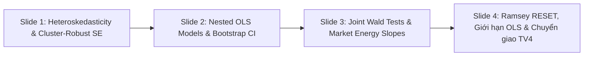

# BÁO CÁO THUYẾT TRÌNH FINAL — THÀNH VIÊN 1 (MODELING & ECONOMETRIC LEAD)
**Dự án:** What Makes a Hit Song? — Phân Tích Hiệu Suất Bảng Xếp Hạng Spotify Việt Nam, Hoa Kỳ & Hàn Quốc (2021–2026)  
**Môn học:** ADY201m — Applied Data Analytics (Chuẩn Assignment v4.1)  
**Phân công Member 1:** Trưởng nhóm Kinh tế lượng & Mô hình hóa OLS (Heteroskedasticity, Cluster-Robust SE, Nested OLS Models, Joint Wald Tests, Market-Specific Energy Slopes, Ramsey RESET & Giới hạn mô hình)  
**Khung thời gian thuyết trình:** 11:30 — 18:30 (Thời lượng: đúng 7.0 phút, bàn giao tiếp theo cho **Member 4**)  

---

## PHẦN 1. NỘI DUNG 4 SLIDE TRÌNH CHIẾU (DECK SLIDES)
*(Dành cho Member 3 ráp trực tiếp vào file trình chiếu chung `reports/presentation_deck.pptx`)*

---

### 🖥️ SLIDE 1: PHƯƠNG SAI THAY ĐỔI & CĂN CỨ BẮT BUỘC CLUSTER-ROBUST SE (CAMERON & MILLER, 2015)
* **Tiêu đề Slide:** **Kiểm Định Phương Sai Sai Số & Chuẩn Hóa Sai Số Chuẩn Cụm (Cluster-Robust SE)**
* **Thời gian trình bày:** 11:30 — 13:15 (1 phút 45 giây)
* **Bố cục nội dung:**
  1. **Khuyết tật phương sai sai số thay đổi (Heteroskedasticity):**
     * **Kiểm định Breusch–Pagan (Train $N = 1,685$):**
       * Thống kê LM: $84.07$ ($p = 3.99 \times 10^{-6}$)
       * Thống kê F: $2.55$ ($p = 2.73 \times 10^{-6}$, $df = [34, 1650]$)
       * *Kết luận:* Bác bỏ triệt để giả thuyết vô hiệu $H_0$ về phương sai đồng nhất ($p < 0.001$).
  2. **Cấu trúc dữ liệu lặp đa thị trường & Tương quan nội cụm:**
     * Mẫu nghiên cứu có **144 bài hát xuất hiện đồng thời ở từ 2 đến 3 thị trường** (102 bài ở 2 nước, 42 bài ở cả 3 nước), chiếm **330 dòng quan sát**.
     * Các quan sát của cùng một ca khúc có sai số tương quan với nhau: $\text{Cov}(u_{it}, u_{is}) \ne 0$.
  3. **Quyết định phương pháp luận bắt buộc:**
     * White SE cổ điển chỉ xử lý được phương sai thay đổi mà vẫn giả định các quan sát độc lập. Khi có tương quan cụm, White SE sẽ **đánh giá thấp sai số chuẩn** (underestimated SE), dẫn đến thổi phồng giá trị $t$-statistic giả tạo.
     * Áp dụng **Sai số chuẩn vững theo cụm track (`spotify_track_id`) theo Cameron & Miller (2015)** xuyên suốt từ Model 1 đến Model 3 để đảm bảo suy luận thống kê chuẩn xác.

---

### 🖥️ SLIDE 2: SO SÁNH CÁC BẬC MÔ HÌNH LỒNG NHAU (NESTED OLS) BẰNG BOOTSTRAP CI
* **Tiêu đề Slide:** **Bậc Thang Mô Hình Kinh Tế Lượng OLS & Đánh Giá Ngoài Mẫu (Test $N=410$)**
* **Thời gian trình bày:** 13:15 — 15:00 (1 phút 45 giây)
* **Bố cục nội dung:**
  1. **Đặc tả cấu trúc các bậc mô hình lồng nhau (Nested OLS Hierarchy):**
     * **Model 1 (Audio Baseline):** $15$ biến âm học Librosa + $1$ hằng số ($16$ hệ số).
     * **Model 2 (Audio + Lyrics):** Bổ sung $6$ biến ca từ NLP ($22$ hệ số).
     * **Model 2b (+ Context):** Bổ sung `release_year_std` và $2$ biến giả thị trường ($25$ hệ số).
     * **Model 3 (Full OLS with Interactions):** $34$ biến giải thích + $1$ hằng số = **$35$ hệ số ước lượng** (gồm $10$ số hạng tương tác thị trường).
  2. **Hiệu năng ngoài mẫu trên tập Test ($N = 410$ quan sát, $382$ ca khúc độc bản):**
     * **Model 1:** $R^2 = -0.0013$, $\text{MAE} = 30.63$.
     * **Model 2:** $R^2 = -0.0016$, $\text{MAE} = 30.79$.
     * **Model 2b:** $R^2 = 0.0365$, 95% CI $[-0.0151, 0.0822]$, $\text{MAE} = 30.06$.
     * **Model 3:** $R^2 = 0.0340$, 95% CI $[-0.0178, 0.0824]$, $\text{MAE} = 29.78$.
  3. **Diễn giải thống kê thận trọng qua Paired Cluster Bootstrap:**
     * **Từ Model 2 lên Model 2b:** $R^2$ tăng theo giá trị ước lượng điểm ($+0.0365$), tuy nhiên khoảng tin cậy 95% của $\Delta R^2$ là $[-0.0151, 0.0822]$ **vẫn bao hàm giá trị 0** $\rightarrow$ Chưa đủ bằng chứng thống kê khẳng định sự cải thiện rõ ràng ngoài mẫu.
     * **Từ Model 2b lên Model 3:** Việc bổ sung 10 số hạng tương tác thị trường làm $R^2$ giảm nhẹ ($0.0340$ so với $0.0365$) và khoảng tin cậy chứa 0 $\rightarrow$ Chưa cho thấy sự cải thiện rõ ràng về khả năng dự đoán ngoài mẫu.

---

### 🖥️ SLIDE 3: KIỂM ĐỊNH WALD KHỐI & SỰ KHÁC BIỆT HỆ SỐ NĂNG LƯỢNG (ENERGY SLOPES)
* **Tiêu đề Slide:** **Kiểm Định Wald Đồng Thời Khối Biến & Phân Kỳ Hệ Số Năng Lượng Giữa Các Nước**
* **Thời gian trình bày:** 15:00 — 16:45 (1 phút 45 giây)
* **Bố cục nội dung:**
  1. **Kiểm định Wald đồng thời theo khối (Joint Wald Block Tests trên Model 3):**
     * **Khối Âm học (Audio - 15 DOF):** $\chi^2 = 39.84, p = 0.00048, p_{\text{Holm}} = 0.00144$ $\rightarrow$ Có ý nghĩa thống kê cao.
     * **Khối Ca từ (Lyrics - 6 DOF):** $\chi^2 = 11.74, p = 0.0679, p_{\text{Holm}} = 0.113$ $\rightarrow$ Chưa đạt mức ý nghĩa 5%.
     * **Khối Bối cảnh (Context - 3 DOF):** $\chi^2 = 39.27, p = 1.52 \times 10^{-8}$ $\rightarrow$ Có ý nghĩa thống kê cực mạnh.
     * **Khối Tương tác thị trường (Interactions - 10 DOF):** $\chi^2 = 17.91, p = 0.0566, p_{\text{Holm}} = 0.113$ $\rightarrow$ Chưa đạt mức ý nghĩa 5% sau hiệu chỉnh Holm.
  2. **Phân kỳ hệ số góc Năng lượng (Market-Specific Energy Slopes):**
     * **Hoa Kỳ (US - Baseline):** $\beta = -4.62$ ($SE = 1.94, p = 0.017$, CI $[-8.43, -0.81]$) $\rightarrow$ Tác động âm có ý nghĩa thống kê; khán giả Mỹ ưa chuộng các ca khúc có mức năng lượng vừa phải, kiểm soát.
     * **Việt Nam (VN):** $\beta = +0.07$ ($SE = 2.38, p = 0.976$, CI $[-4.59, +4.73]$) $\rightarrow$ Hệ số gần 0, không có ý nghĩa thống kê.
     * **Hàn Quốc (KR):** $\beta = -0.93$ ($SE = 2.12, p = 0.660$, CI $[-5.09, +3.22]$) $\rightarrow$ Không có ý nghĩa thống kê.
     * *Kết luận:* Hiệu ứng của đặc trưng âm học không đồng nhất giữa các nền văn hóa âm nhạc.

---

### 🖥️ SLIDE 4: RAMSEY RESET, GIỚI HẠN DẠNG HÀM VÀ CHUYỂN GIAO TIẾP THEO
* **Tiêu đề Slide:** **Kiểm Định Dạng Hàm Ramsey RESET & Giới Hạn Phương Pháp Luận Của OLS**
* **Thời gian trình bày:** 16:45 — 18:30 (1 phút 45 giây)
* **Bố cục nội dung:**
  1. **Kiểm định dạng hàm Ramsey RESET:**
     * **Kết quả kiểm định Wald cụm (Assignment v4.1):** $\chi^2 = 9.22, df = 2, p = 0.010$.
     * *Diễn giải chuẩn mực:* Bác bỏ giả thuyết dạng hàm tuyến tính chuẩn xác ($p = 0.010$). Kết quả cho thấy mô hình OLS có thể gặp vấn đề về đặc tả hoặc dạng hàm, gợi ý cấu trúc quan hệ thực tế có thể phức tạp hơn dạng tuyến tính thuần túy.
  2. **Giới hạn phương pháp luận của mô hình OLS:**
     * $R^2$ ngoài mẫu ở mức khiêm tốn ($3.4\%$) phản ánh thành bại của bài hát chịu sự chi phối lớn của các yếu tố ngoại sinh chưa quan sát được (unobserved factors: viral marketing, nghệ sĩ danh tiếng, xu hướng mạng xã hội).
     * Mọi ước lượng chỉ phản ánh **liên hệ thống kê quan sát được (association)**, tuyệt đối không suy diễn quan hệ nhân quả.
  3. **Chuyển giao nội dung cho Member 4 (18:30):**
     * Để giải quyết các nghi vấn về dạng hàm phi tuyến từ kiểm định RESET, xin mời **Member 4** trình bày về mô hình đối chuẩn **Random Forest Benchmark ($R^2 = 0.0686, \text{MAE} = 29.13$)** và hệ thống Dashboard ứng dụng.

---

## PHẦN 2. KỊCH BẢN THUYẾT TRÌNH (SPEECH SCRIPT — 7.0 PHÚT)
*(Khẩu khí học thuật, chính xác, bám sát timeline 11:30 – 18:30 theo phân công v4.1)*

> **[11:30 — 13:15] SLIDE 1: HETEROSKEDASTICITY & CLUSTER-ROBUST STANDARD ERRORS**  
> *"Kính thưa Thầy/Cô và Hội đồng, em là Thành viên 1, đảm nhiệm vai trò **Modeling & Econometric Lead** của đề tài. Phần trình bày của em tập trung vào kiểm định giả định mô hình, ước lượng chuỗi mô hình OLS lồng nhau và phân tích các hệ số kinh tế lượng.*  
>  
> *(Chuyển sang Slide 1)*  
> *Thách thức phương pháp luận đầu tiên mà nhóm phải đối mặt khi ước lượng mô hình hồi quy là kiểm tra các giả định cổ điển của OLS. Khi thực hiện kiểm định Breusch–Pagan trên tập Train $N = 1,685$ quan sát, giá trị thống kê $LM$ đạt $84.07$ với $p = 3.99 \times 10^{-6}$, bác bỏ hoàn toàn giả định phương sai sai số đồng nhất.*  
> *Đặc biệt, về mặt cấu trúc dữ liệu, mẫu của nhóm có **144 ca khúc xuất hiện đồng thời ở từ 2 đến 3 thị trường, tạo ra 330 dòng quan sát lặp lại**. Điều này vi phạm nghiêm trọng giả định về tính độc lập giữa các sai số, dẫn tới hiện tượng tương quan nội cụm: $\text{Cov}(u_{it}, u_{is}) \ne 0$.*  
> *Nếu chỉ sử dụng sai số chuẩn OLS thông thường hoặc White SE, sai số chuẩn sẽ bị đánh giá thấp (underestimated), làm cho giá trị kiểm định $t$ bị thổi phồng giả tạo và dẫn tới kết luận sai lệch về ý nghĩa thống kê. Vì vậy, em đã chuẩn hóa bắt buộc việc áp dụng **Sai số chuẩn vững theo cụm track (`spotify_track_id`) theo phương pháp luận kinh điển của Cameron & Miller (2015)** xuyên suốt từ Model 1 đến Model 3 để đảm bảo suy luận thống kê vững chắc."*  
>  
> ---  
>  
> **[13:15 — 15:00] SLIDE 2: NESTED OLS MODELS & ĐÁNH GIÁ NGOÀI MẪU**  
> *(Chuyển sang Slide 2)*  
> *Tiếp theo, nhóm xây dựng chuỗi 4 bậc mô hình hồi quy lồng nhau để phân tách đóng góp của từng nhóm đặc trưng: Model 1 là Audio Baseline gồm 15 biến âm học Librosa; Model 2 bổ sung 6 biến ca từ NLP; Model 2b bổ sung biến năm phát hành và biến giả thị trường; và Model 3 là Full OLS với 34 biến giải thích cùng 1 hằng số, tương ứng **35 hệ số ước lượng**, bao gồm 10 số hạng tương tác thị trường.*  
>  
> *Khi đánh giá hiệu năng ngoài mẫu trên tập Test độc lập gồm $410$ quan sát tương ứng $382$ ca khúc độc bản:*  
> *Model 1 và Model 2 cho $R^2$ âm nhẹ ($-0.0013$ và $-0.0016$) với MAE quanh mức $30.7$.*  
> *Khi chuyển sang Model 2b, $R^2$ ước lượng điểm tăng lên $0.0365$ và MAE giảm xuống $30.06$. Tuy nhiên, qua kiểm định Paired Cluster Bootstrap, khoảng tin cậy 95% của $\Delta R^2$ là $[-0.0151, 0.0822]$ **vẫn bao hàm giá trị 0**. Vì vậy, về mặt học thuật nghiêm cẩn, chúng em kết luận: dù $R^2$ có tăng theo ước lượng điểm, nhưng dữ liệu ngoài mẫu chưa đủ bằng chứng thống kê để khẳng định việc thêm `release_year` tạo ra bước cải thiện rõ ràng.*  
> *Tương tự, khi chuyển từ Model 2b lên Model 3, việc bổ sung 10 số hạng tương tác thị trường làm $R^2$ giảm nhẹ về $0.0340$ (MAE $= 29.78$), cho thấy các số hạng tương tác phức tạp chưa mang lại sự cải thiện rõ ràng về khả năng dự đoán ngoài mẫu."*  
>  
> ---  
>  
> **[15:00 — 16:45] SLIDE 3: JOINT WALD TESTS & PHÂN KỲ HỆ SỐ NĂNG LƯỢNG**  
> *(Chuyển sang Slide 3)*  
> *Để đánh giá ý nghĩa thống kê đồng thời của từng khối biến trong Model 3, em tiến hành kiểm định Joint Wald Test với sai số chuẩn cụm:*  
> *Khối Âm học ($\chi^2 = 39.84, p = 0.00048$) và Khối Bối cảnh ($\chi^2 = 39.27, p < 0.001$) đều có ý nghĩa thống kê rất cao sau hiệu chỉnh Holm. Ngược lại, Khối Ca từ ($p = 0.068$) và Khối Tương tác thị trường ($p = 0.057$) chưa đạt mức ý nghĩa 5%.*  
>  
> *Đặc biệt, khi phân rã độ dốc tác động theo từng thị trường (Market-Specific Slopes), biến Năng lượng (`energy`) thể hiện sự phân kỳ văn hóa rất rõ nét:*  
> *Tại thị trường Hoa Kỳ (đóng vai trò Baseline), hệ số góc của năng lượng âm và có ý nghĩa thống kê: $\beta = -4.62$ ($SE = 1.94, p = 0.017$, CI $[-8.43, -0.81]$). Điều này cho thấy tại Mỹ, các ca khúc đạt thứ hạng cao có xu hướng duy trì mức năng lượng kiểm soát, vừa phải.*  
> *Trong khi đó, tại Việt Nam ($\beta = +0.07, p = 0.976$) và Hàn Quốc ($\beta = -0.93, p = 0.660$), hệ số góc đều không có ý nghĩa thống kê. Sự phân kỳ này khẳng định đặc trưng âm học không tác động một chiều mà có tính đặc thù theo từng thị hiếu địa phương."*  
>  
> ---  
>  
> **[16:45 — 18:30] SLIDE 4: RAMSEY RESET, GIỚI HẠN OLS & CHUYỂN GIAO THUYẾT TRÌNH**  
> *(Chuyển sang Slide 4)*  
> *Cuối cùng, em thực hiện kiểm định Ramsey RESET để kiểm tra giả định về dạng hàm tuyến tính. Kết quả kiểm định Wald cụm cho $\chi^2 = 9.22$ với $df = 2$ và $p = 0.010$, bác bỏ giả thuyết dạng hàm tuyến tính chuẩn xác.*  
> *Kết quả có ý nghĩa thống kê này gợi ý rằng mô hình hồi quy có thể gặp vấn đề về đặc tả dạng hàm, cho thấy mối liên hệ thực tế giữa các đặc trưng âm nhạc và thứ hạng chart có thể phức tạp hơn một đường thẳng thuần túy.*  
>  
> *Về mặt giới hạn phương pháp luận, nhóm xin nhấn mạnh rằng $R^2$ Test đạt mức $3.4\%$ phản ánh tính chất thực tế của ngành công nghiệp âm nhạc, nơi thành công thương mại chịu ảnh hưởng lớn từ các yếu tố ngoại sinh chưa quan sát được (unobserved factors) như truyền thông hay danh tiếng nghệ sĩ. Toàn bộ kết quả đều được nhóm diễn giải dưới dạng liên hệ thống kê (association), không suy diễn quan hệ nhân quả.*  
>  
> *Để trả lời cho câu hỏi: Liệu một cấu trúc phi tuyến linh hoạt có thể khai thác tốt hơn các tín hiệu dữ liệu này hay không? Sau đây, em xin được kết thúc phần trình bày của mình và chuyển giao phần tiếp theo cho **Member 4** để giới thiệu về mô hình đối chuẩn **Random Forest Benchmark** và phân hệ ứng dụng Dashboard. Xin trân trọng cảm ơn Thầy/Cô!"*

---

## PHẦN 3. BỘ CÂU HỎI & TRẢ LỜI PHẢN BIỆN CHUYÊN MÔN (Q&A DEFENSE)

### ❓ Câu 1: Tại sao nhóm lại loại bỏ biến `spectral_bandwidth` khỏi ma trận OLS?
> **Trả lời:**  
> *"Dạ thưa Thầy/Cô, OLS không giả định rằng các biến giải thích không được tương quan với nhau. Tuy nhiên, tương quan thực nghiệm giữa `spectral_centroid` và `spectral_bandwidth` lên tới $r = 0.897$. Mức độ tương quan quá cao này gây ra hiện tượng **đa cộng tuyến nghiêm trọng (severe multicollinearity)**, làm tăng vọt phương sai và sai số chuẩn của các hệ số ước lượng, khiến việc ước lượng và phân tách tác động riêng phần (ceteris paribus) của từng biến trở nên không chính xác và bất ổn định. Vì vậy, nhóm quyết định loại bỏ `spectral_bandwidth` và giữ lại `spectral_centroid` cùng `energy_std`, bảo toàn được thông tin độ sáng và năng lượng vật lý mà vẫn đưa VIF toàn bộ ma trận về mức an toàn dưới 3.8."*

### ❓ Câu 2: Tại sao kiểm định Breusch–Pagan đã ra $p < 0.001$ mà nhóm không dùng White SE mà phải dùng Cluster SE theo track?
> **Trả lời:**  
> *"Dạ thưa Thầy/Cô, White SE chỉ xử lý được phương sai thay đổi (heteroskedasticity) trong điều kiện các quan sát độc lập nhau. Tuy nhiên, mẫu của nhóm có 144 bài hát xuất hiện ở từ 2 đến 3 thị trường, tạo ra 330 dòng quan sát lặp lại. Giữa các thị trường của cùng một ca khúc, sai số chắc chắn có tương quan nội cụm ($\text{Cov}(u_{it}, u_{is}) \ne 0$). Theo Cameron & Miller (2015), nếu tồn tại tương quan cụm mà vẫn dùng White SE thì sai số chuẩn vẫn bị chệch xuống dưới (underestimated), làm giá trị kiểm định t bị thổi phồng giả tạo. Vì vậy bắt buộc phải dùng Cluster-Robust SE phân cụm theo `spotify_track_id` để suy luận thống kê được chuẩn xác."*

### ❓ Câu 3: Kiểm định Ramsey RESET cho $p = 0.010$, có phải điều này chứng minh chắc chắn mối quan hệ trong dữ liệu là phi tuyến?
> **Trả lời:**  
> *"Dạ thưa Thầy/Cô, về mặt kinh tế lượng, kiểm định Ramsey RESET bác bỏ giả thuyết $H_0$ ($p = 0.010$) chỉ cho thấy mô hình có bằng chứng về **sai dạng hàm hoặc khuyết tật đặc tả (functional form misspecification)**. Điều này gợi ý rằng dạng hàm tuyến tính thuần túy có thể chưa bao quát hết cấu trúc quan hệ, nhưng chưa đủ để khẳng định chắc chắn bản chất mối quan hệ là phi tuyến nào. Đây chính là lý do phương pháp luận nhóm xây dựng kiến trúc song hành (Dual-Model), sử dụng Random Forest Benchmark để đối chuẩn kiểm chứng ngoài mẫu như Member 4 sẽ trình bày ngay sau đây ạ."*
