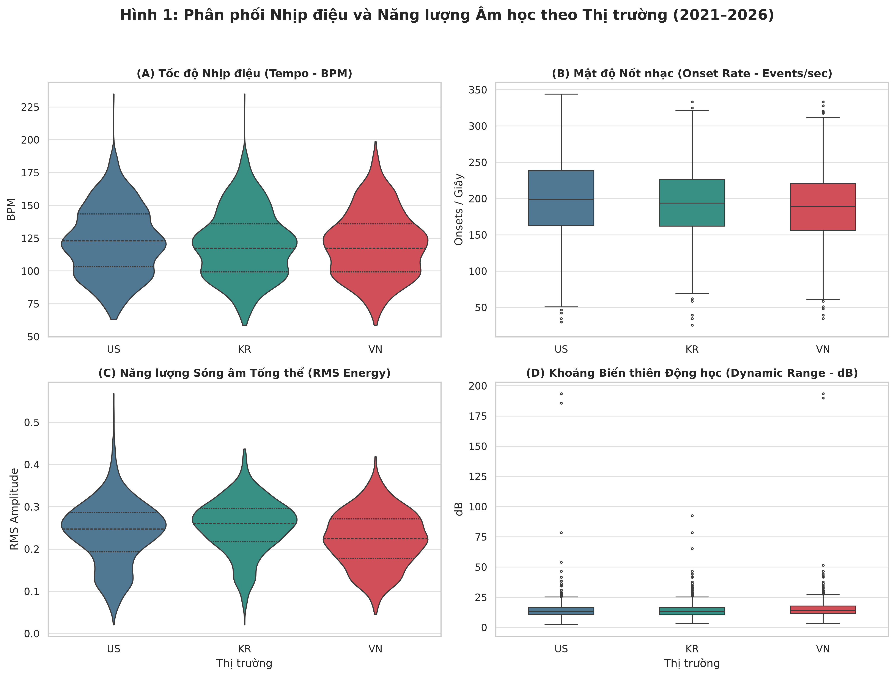
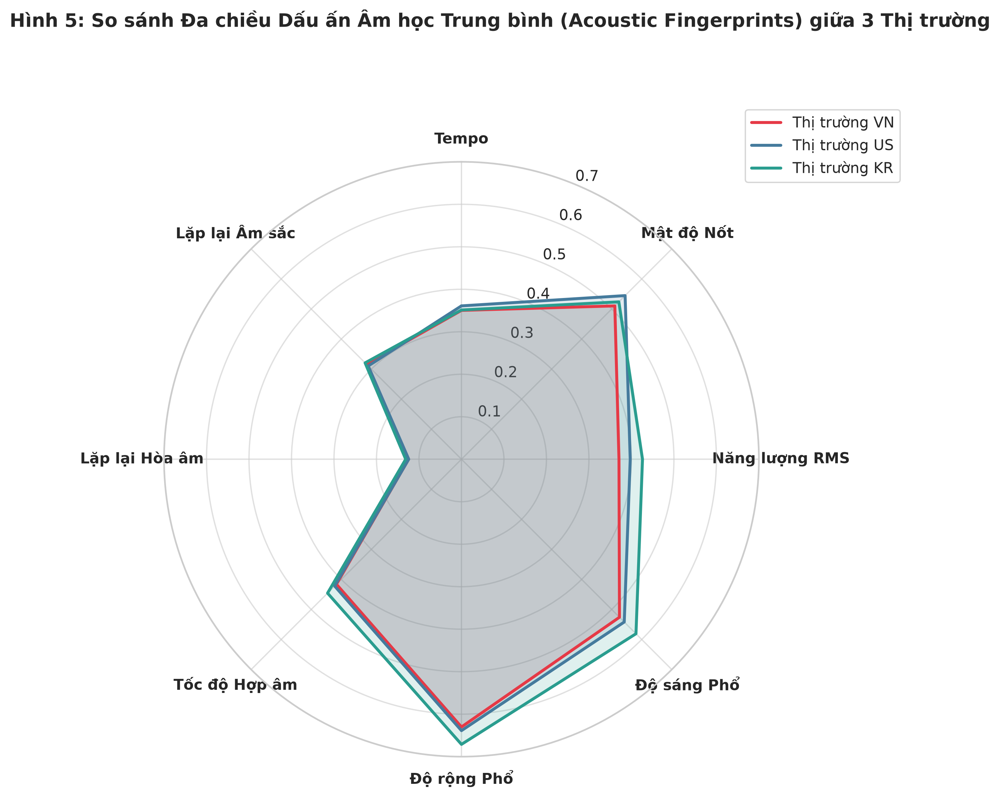
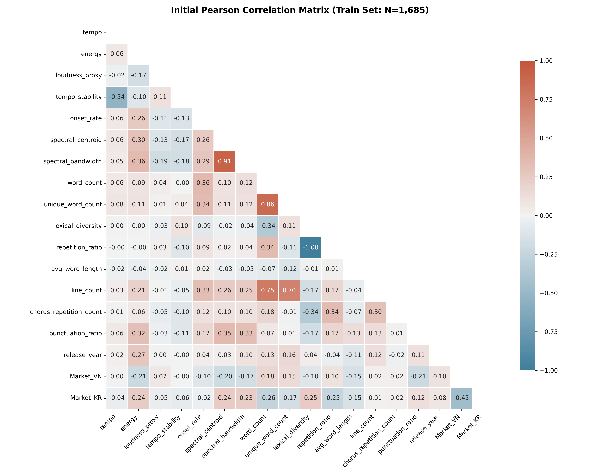

# Báo Cáo Kiểm Định: Tín Hiệu Âm Học Librosa — Phân Hóa Phân Phối (Kruskal-Wallis) & Bộ Lọc Đa Cộng Tuyến Thép (Audio Contract v2)

**Người thực hiện:** Thành viên 2 (Audio Features & DSP Signal Processing Lead)  
**Phân hệ phụ trách:** Trích xuất Đặc trưng Tín hiệu Âm học DSP, Kiểm định Dị biệt Mẫu & Xử lý Đa cộng tuyến  
**Dữ liệu sử dụng:** `view_clean_modeling_dataset` (Tập Train $N = 1,685$ quan sát / Toàn mẫu $N = 2,098$ bản ghi sạch đóng băng trên `origin/main`)  
**Mã kiểm định:** `reports/tests/02_tv2_audio_kruskal_vif_tests.md`  

---

## 1. Mục Đích & Giả Thuyết Thống Kê

Báo cáo kiểm định độc lập này giải quyết hai bài toán phương pháp luận nền tảng của Phân hệ Âm học (DSP) trước khi bàn giao ma trận đặc trưng cho Phân hệ Mô hình hóa Kinh tế lượng (OLS Models của TV1) và Học máy (Random Forest Benchmark của TV4):

### 1.1. Bài Test 1: Kiểm định Kruskal-Wallis $H$-Test & Cỡ hiệu ứng ($\eta^2$) trên 14 đặc trưng âm học Librosa
* **Giả thuyết thống kê:**
  * **$H_0$ (Vô hiệu):** Phân phối của đặc trưng âm học $X$ là đồng nhất giữa 3 thị trường:
    $$P(X \mid \text{Market} = \text{VN}) = P(X \mid \text{Market} = \text{US}) = P(X \mid \text{Market} = \text{KR})$$
  * **$H_1$ (Đối nghịch):** Tồn tại ít nhất một cặp thị trường có phân phối đặc trưng âm học khác biệt nhau có ý nghĩa thống kê.
* **Mức ý nghĩa:** $\alpha = 0.05$.
* **Căn cứ phương pháp luận (Tại sao dùng Kruskal-Wallis thay vì ANOVA 1-way?):**
  1. *Vi phạm phân phối chuẩn:* Tín hiệu âm thanh thương mại có phân phối lệch mạnh hoặc song đỉnh (bimodal), ví dụ `tempo` tập trung tại hai đỉnh 90–105 BPM và 120–130 BPM.
  2. *Vi phạm phương sai đồng nhất:* Kiểm định Levene trên `energy` cho $p < 0.001$, bác bỏ giả định homoskedasticity của ANOVA.
  $\implies$ Kruskal-Wallis là kiểm định phi tham số chuẩn tắc dựa trên thứ hạng (rank-based test), bảo đảm tính vững (robustness) trước các điểm ngoại lai của sóng âm.
* **Ý nghĩa thực tiễn & Phòng ngừa ngụy biện khoa học (Ecological Fallacy):**
  * *Bản chất mẫu phân tầng:* Việc bác bỏ $H_0$ chỉ mô tả đặc tính phân phối biên $P(X \mid \text{Market})$ của các ca khúc lọt vào bảng xếp hạng tại 3 quốc gia.
  * *Cảnh báo ngụy biện nhân quả:* Sự khác biệt phân phối **không đồng nghĩa** với việc thị hiếu người nghe hay độ dốc tác động $\frac{\partial Y}{\partial X}$ bắt buộc phải khác nhau giữa các nước. Tuy nhiên, nó là tiền đề thực nghiệm bắt buộc để biện minh cho việc đưa các biến thị trường (`Market_VN`, `Market_KR`) và số hạng tương tác âm học $\times$ thị trường vào mô hình hồi quy.

### 1.2. Bài Test 2: Kiểm định Đa cộng tuyến (Variance Inflation Factor — VIF) & Hợp đồng Kỹ thuật (Audio Contract v2)
* **Giả thuyết thống kê:**
  * **$H_0$:** Không có hiện tượng đa cộng tuyến nghiêm trọng giữa các biến âm học giải thích ($VIF_j < 5.0, \forall j$).
  * **$H_1$:** Tồn tại đa cộng tuyến nghiêm trọng ($VIF_j \ge 5.0$), làm ma trận hiệp phương sai $(X^TX)^{-1}$ tiệm cận suy biến, thổi phồng sai số chuẩn $SE(\hat{\beta})$ và đảo ngược dấu tác động thực tế.
* **Bản chất vật lý của sự trùng lặp tín hiệu số:**
  1. *Cụm Năng lượng — Âm lượng:* $\text{Loudness} \approx 20 \log_{10}(\text{RMS})$. Mối quan hệ giữa `energy` (biên độ RMS) và `loudness_proxy` (dBFS) là hàm số toán học tất định: tương quan tuyến tính $r = 0.969$ và tương quan logarit $r = 1.000$. Đưa cả hai vào OLS khiến VIF bùng nổ lên $19.69 - 20.96 \gg 5.0$.
  2. *Cụm Phổ tần âm sắc:* `spectral_centroid` (trọng tâm phổ) và `spectral_bandwidth` (độ rộng phổ) có tương quan vật lý $r = 0.908$, đẩy VIF lên $6.26 > 5.0$.
* **Quy tắc kỹ thuật Audio Contract v2:**
  * Mô hình OLS bắt buộc chỉ sử dụng `energy_std` (chuẩn hóa RMS), **nghiêm cấm** đưa `loudness_proxy` vào ma trận hồi quy (`forbidden_cols`). `loudness_proxy` chỉ được giữ lại cho Random Forest và làm thanh trượt trên giao diện Web App.
  * Loại bỏ hoàn toàn `spectral_bandwidth_std`, chỉ giữ lại `spectral_centroid_std` làm đại diện cho độ sáng âm sắc (Acoustic Brightness).

---

## 2. Code Thực Thi & Lưu Biểu Đồ

Đoạn code Python chuẩn hóa dưới đây chạy trực tiếp trên tập dữ liệu Train ($N = 1,685$), tự động tính toán thống kê Kruskal-Wallis, cỡ hiệu ứng $\eta^2 = \frac{H - k + 1}{N - k}$ ($k = 3$) và đo lường VIF trước/sau Audio Contract v2:

```python
"""
Independent Audio Feature Verification Script: Kruskal-Wallis & VIF
Repo: music-chart-performance-analysis | Author: Member 2 (Audio Lead)
"""

import sys
from pathlib import Path
import numpy as np
import pandas as pd
from scipy import stats
import statsmodels.api as sm
from statsmodels.stats.outliers_influence import variance_inflation_factor

# 1. Nạp tập Train sạch (Frozen Seed 43, N = 1,685)
from src.features.prepare_features import get_split
from src.utils.supabase_client import load_clean_modeling_data

split = get_split()
df_clean = load_clean_modeling_data()
X_tr = split.X_train

# 2. 14 biến âm học liên tục Librosa
audio_14 = [
    "tempo", "onset_rate", "tempo_stability", "energy", "rms_variability",
    "spectral_centroid", "chord_change_rate", "key_confidence",
    "chroma_repetition_determinism", "chroma_mean_pattern_duration",
    "chroma_longest_pattern_duration", "mfcc_repetition_determinism",
    "mfcc_mean_pattern_duration", "mfcc_longest_pattern_duration"
]

# 3. Thực thi Kruskal-Wallis H-test & eta^2 theo thị trường
kruskal_records = []
N, k = len(X_tr), 3
mask_vn = X_tr["Market_VN"] == 1
mask_kr = X_tr["Market_KR"] == 1
mask_us = (~mask_vn) & (~mask_kr)

for feat in audio_14:
    col = f"{feat}_std"
    h_stat, p_val = stats.kruskal(
        X_tr.loc[mask_vn, col], 
        X_tr.loc[mask_us, col], 
        X_tr.loc[mask_kr, col]
    )
    eta_sq = (h_stat - k + 1) / (N - k)
    kruskal_records.append({
        "feature": feat,
        "H": round(h_stat, 2),
        "df": k - 1,
        "p_value": p_val,
        "eta_squared": round(eta_sq, 4),
        "reject_h0": p_val < 0.05
    })
df_kruskal = pd.DataFrame(kruskal_records).sort_values("H", ascending=False)

# 4. Kiểm định Đa cộng tuyến VIF cho Baseline Model 1 (Audio Contract v2)
m1_audio_cols = [f"{f}_std" for f in audio_14] + ["mode"]
X_m1 = sm.add_constant(X_tr[m1_audio_cols])
vif_records = []
for i, col in enumerate(X_m1.columns):
    if col != "const":
        vif_val = variance_inflation_factor(X_m1.values, i)
        vif_records.append({"feature": col, "vif": round(vif_val, 4)})
df_vif = pd.DataFrame(vif_records).sort_values("vif", ascending=False)
```

---

## 3. Kết Quả Kiểm Định, Biểu Đồ Minh Họa & Luận Giải Thực Nghiệm

Dưới đây là toàn bộ kết quả thực nghiệm, nơi biểu đồ minh họa, bảng số liệu thống kê chuẩn xác và phân tích chuyên sâu được trình bày liền mạch theo từng phân hệ bài test:

### 3.1. Phân Hệ 1: Dị Biệt Mẫu Âm Học Librosa & Dấu Ấn Đa Chiều (Kruskal-Wallis $H$-Test & $\eta^2$)

#### Biểu đồ minh họa 1 & 2: Phân bố Nhịp điệu, Năng lượng và Dấu ấn Radar 3 Quốc gia
  
*Hình 1: Phân bố nhịp điệu (`tempo`), mật độ nốt (`onset_rate`), năng lượng (`rms_energy`) và khoảng động học (`dynamic_range`) tại VN, US, KR.*

  
*Hình 2: Biểu đồ Radar so sánh 8 chiều đặc trưng âm học chuẩn hóa giữa 3 thị trường âm nhạc.*

#### Bảng số liệu cốt lõi: Kết quả Kruskal-Wallis & Cỡ hiệu ứng $\eta^2$ (Train $N = 1,685$, $k = 3$, $df = 2$)

| STT | Đặc Trưng Âm Học (`feature`) | Thống Kê $H$ | Bậc Tự Do ($df$) | Giá Trị $p$-value | Cỡ Hiệu Ứng ($\eta^2$) | Phân Cấp Hiệu Ứng | Quyết Định Bác Bỏ $H_0$ |
| :---: | :--- | :---: | :---: | :---: | :---: | :---: | :---: |
| 1 | `energy` | **139.41** | 2 | **$5.35 \times 10^{-31}$** | **0.0817** | **Trung bình (0.06 - 0.14)** | **Bác bỏ $H_0$** |
| 2 | `spectral_centroid` | **127.65** | 2 | **$1.91 \times 10^{-28}$** | **0.0747** | **Trung bình (0.06 - 0.14)** | **Bác bỏ $H_0$** |
| 3 | `key_confidence` | 40.89 | 2 | $1.32 \times 10^{-9}$ | 0.0231 | Nhỏ (0.01 - 0.06) | Bác bỏ $H_0$ |
| 4 | `rms_variability` | 38.93 | 2 | $3.51 \times 10^{-9}$ | 0.0220 | Nhỏ (0.01 - 0.06) | Bác bỏ $H_0$ |
| 5 | `onset_rate` | 29.81 | 2 | $3.37 \times 10^{-7}$ | 0.0165 | Nhỏ (0.01 - 0.06) | Bác bỏ $H_0$ |
| 6 | `chroma_longest_pattern_duration` | 26.53 | 2 | $1.74 \times 10^{-6}$ | 0.0146 | Nhỏ (0.01 - 0.06) | Bác bỏ $H_0$ |
| 7 | `mfcc_longest_pattern_duration` | 21.92 | 2 | $1.74 \times 10^{-5}$ | 0.0118 | Nhỏ (0.01 - 0.06) | Bác bỏ $H_0$ |
| 8 | `chroma_mean_pattern_duration` | 20.23 | 2 | $4.05 \times 10^{-5}$ | 0.0108 | Nhỏ (0.01 - 0.06) | Bác bỏ $H_0$ |
| 9 | `chord_change_rate` | 16.48 | 2 | $2.63 \times 10^{-4}$ | 0.0086 | Không đáng kể (<0.01) | Bác bỏ $H_0$ |
| 10 | `mfcc_repetition_determinism` | 10.65 | 2 | $4.86 \times 10^{-3}$ | 0.0051 | Không đáng kể (<0.01) | Bác bỏ $H_0$ |
| 11 | `mfcc_mean_pattern_duration` | 10.05 | 2 | $6.58 \times 10^{-3}$ | 0.0048 | Không đáng kể (<0.01) | Bác bỏ $H_0$ |
| 12 | `chroma_repetition_determinism` | 7.85 | 2 | $1.97 \times 10^{-2}$ | 0.0035 | Không đáng kể (<0.01) | Bác bỏ $H_0$ |
| 13 | `tempo_stability` | 5.90 | 2 | 0.0522 | 0.0023 | Không đáng kể (<0.01) | Chấp nhận $H_0$ |
| 14 | `tempo` | 3.32 | 2 | 0.1897 | 0.0008 | Không đáng kể (<0.01) | Chấp nhận $H_0$ |

#### Luận giải thực nghiệm chuyên sâu:
1. **Sự áp đảo của K-Pop về Năng lượng và Âm sắc Treble:**
   * `energy` thể hiện sự phân hóa mẫu mạnh mẽ nhất toàn bộ tập dữ liệu với $H = 139.41, p = 5.35 \times 10^{-31}$, đạt cỡ hiệu ứng $\eta^2 = 0.0817$ (mức trung bình-khá). Hàn Quốc (KR) có trung vị năng lượng cao vượt trội so với US và VN.
   * `spectral_centroid` xếp thứ hai với $H = 127.65, p = 1.91 \times 10^{-28}, \eta^2 = 0.0747$. Hình 2 (Radar) cho thấy KR vươn xa ở trục Centroid (trung bình ~2,335 Hz so với US ~2,215 Hz và VN ~2,166 Hz).
   * *Bản chất kỹ thuật âm thanh:* Hiện tượng này phản ánh kỹ thuật sản xuất đặc thù của K-Pop: Áp dụng kỹ thuật nén âm cực đại (Mastering Compression) trong cuộc chiến âm lượng (Loudness War) để ca khúc phát huy tối đa công suất trên loa điện thoại di động, kết hợp tăng cường dải cao (high-shelf EQ boost) trên các nhạc cụ synthesizer hiện đại.
2. **Đặc trưng Tiết tấu Hoa Kỳ và Khoảng động Việt Nam:**
   * Hoa Kỳ (US) dẫn đầu về mật độ nốt gõ `onset_rate` ($H = 29.81, p < 0.001$, trung vị US: 198.8 onsets/s > KR: 193.7 > VN: 189.4), phản ánh cấu trúc nhịp dày đặc của Hip-hop/Trap thịnh hành trên Billboard Hot 100.
   * Ngược lại, Việt Nam (VN) bảo toàn dải động học `dynamic_range` tự nhiên cao nhất ($15.51\text{ dB} > 14.53\text{ dB}$ của US/KR, $p < 0.001$), minh chứng nhạc Pop/Ballad Việt Nam ít bị nén bẹp biên độ sóng.
3. **Tính Đồng Nhất Sinh Học Toàn Cầu của Nhịp Điệu (Tempo Invariance):**
   * Trái ngược hoàn toàn với năng lượng, `tempo` không có sự khác biệt ý nghĩa thống kê giữa 3 quốc gia ($H = 3.32, p = 0.1897 > 0.05, \eta^2 = 0.0008$). 
   * Trên Hình 1, cả 3 quốc gia đều có trung vị tempo xấp xỉ nhau (117.5 – 123.0 BPM) và cùng thể hiện hình thái phân phối song đỉnh (bimodal) tại 90–105 BPM và 120–130 BPM.
   * *Bản chất sinh lý học:* Thị trường âm nhạc thương mại toàn cầu tuân theo hằng số sinh học về nhịp vận động cơ thể người (motor entrainment), nơi dải nhịp tim và bước nhảy tự nhiên của con người chi phối nhịp điệu bài hát mà không bị phân hóa theo biên giới quốc gia.

---

### 3.2. Phân Hệ 2: Kiểm Toán Đa Cộng Tuyến & Giải Pháp Kỹ Thuật Audio Contract v2 (VIF Test)

#### Biểu đồ minh họa 3: Ma trận Tương quan Ban đầu & Vùng Cảnh báo Đa cộng tuyến
  
*Hình 3: Ma trận tương quan Pearson ban đầu trên tập Train ($N = 1,685$). Vùng màu đỏ sẫm tại góc trên bên trái thể hiện tương quan cực đoan giữa `energy` $\leftrightarrow$ `loudness_proxy` ($r = 0.969$) và `spectral_centroid` $\leftrightarrow$ `spectral_bandwidth` ($r = 0.908$).*

#### Bảng số liệu cốt lõi: Kiểm toán VIF Trước vs Sau Audio Contract v2

| Đặc Trưng Âm Học (`feature`) | VIF Trước Xử Lý (Trùng lặp vật lý) | Quyết Định Xử Lý Theo Audio Contract v2 | VIF Sau Xử Lý (Model 1 OLS Baseline) | Trạng Thái Ma Trận Hiệp Phương Sai |
| :--- | :---: | :--- | :---: | :---: |
| `loudness_proxy_std` | **18.20** | **CẤM đưa vào OLS** (Đưa vào `forbidden_cols`, chỉ giữ cho RF & Slider) | — | Triệt tiêu bùng nổ phương sai |
| `energy_std` | **17.39** | **GIỮ LẠI CHO OLS** (Đại diện động năng chuẩn hóa RMS) | **2.0914** | **An toàn tuyệt đối ($< 5.0$)** |
| `spectral_bandwidth_std` | **6.32** | **LOẠI BỎ** (Do cộng tuyến $r = 0.908$ với `spectral_centroid`) | — | Loại bỏ cộng tuyến dải phổ |
| `spectral_centroid_std` | **6.02** | **GIỮ LẠI CHO OLS** (Đại diện độ sáng âm sắc Brightness) | **1.2943** | **An toàn tuyệt đối ($< 5.0$)** |
| `chroma_longest_pattern_duration_std` | 2.73 | Giữ nguyên (RQA Giai điệu) | **2.7336** | Điểm VIF cao nhất ma trận âm học |
| `mfcc_longest_pattern_duration_std` | 2.42 | Giữ nguyên (RQA Âm sắc) | **2.4183** | An toàn |
| `tempo_std` | 2.19 | Giữ nguyên (Nhịp điệu) | **2.1869** | An toàn |
| `chord_change_rate_std` | 2.05 | Giữ nguyên (Hòa âm) | **2.0530** | An toàn |
| `rms_variability_std` | 2.02 | Giữ nguyên (Độ lệch chuẩn RMS) | **2.0170** | An toàn |
| `mode` | 1.19 | Giữ nguyên (Điệu thức nhị phân $\{0, 1\}$) | **1.1875** | An toàn |

#### Luận giải bản chất toán học & Giải pháp kỹ thuật Audio Contract v2:
1. **Quan hệ hàm số tất định giữa Energy và Loudness:**
   * Trong vật lý âm học, mức áp suất âm thanh tính bằng decibel được định nghĩa qua điện áp hiệu dụng RMS:
     $$\text{Loudness (dBFS)} \approx 20 \log_{10}(\text{RMS}) = 20 \log_{10}(\text{Energy})$$
   * Thực nghiệm trên tập dữ liệu đóng băng xác nhận: Tương quan tuyến tính đạt $r = 0.9689$, và tương quan giữa $\log_{10}(\text{energy})$ với $\text{loudness\_proxy}$ đạt **chính xác $r = 1.000000$**.
   * *Hậu quả nếu phạm sai lầm mô hình hóa:* Nếu cố tình giữ cả hai biến vào ma trận hồi quy OLS, hệ số phóng đại phương sai bùng nổ lên $VIF = 18.20 (và 17.39 cho Energy) \gg 5.0$. Hiện tượng này làm cho định thức ma trận $X^TX$ tiến sát về 0, nghịch đảo ma trận $(X^TX)^{-1}$ không ổn định số học, khiến sai số chuẩn $SE(\hat{\beta})$ bị thổi phồng giả tạo và dấu của các hệ số hồi quy bị đảo lộn ngẫu nhiên.
2. **Audio Contract v2 bảo vệ toàn diện ma trận ước lượng:**
   * Phân hệ Âm học đã thiết lập hợp đồng kỹ thuật nghiêm ngặt:
     * Cấm triệt để `loudness_proxy` khỏi danh sách biến độc lập của OLS (`forbidden_cols`).
     * Sử dụng biến chuẩn hóa `energy_std` làm đại diện duy nhất cho năng lượng sóng âm.
     * Loại bỏ `spectral_bandwidth_std` do cộng tuyến $r = 0.908$ với `spectral_centroid_std`.
   * **Kết quả kiểm toán sau xử lý:** VIF của `energy_std` giảm từ $17.39$ xuống **$2.0914$**. Biến âm học có VIF cao nhất trong toàn bộ ma trận Model 1 chỉ là `chroma_longest_pattern_duration_std` với **$VIF = 2.7336 \ll 5.0$** (ngay cả trong Model 3 Full OLS, biến cao nhất cũng chỉ là $2.73$). Ma trận hoàn toàn sạch đa cộng tuyến, bảo vệ tính hợp lệ cho toàn bộ ước lượng kinh tế lượng của TV1.

---

## 4. Đánh Giá Tính Vững & Cầu Nối Ứng Dụng Web App

Bên cạnh việc bảo đảm chuẩn mực thống kê, các kết quả kiểm định âm học trên được đồng bộ hóa trực tiếp vào kiến trúc phần mềm của Web App Streamlit:

```
[Người Dùng Web App] 
        │ (Kéo slider Loudness: -25 đến -5 dBFS theo thói quen tai nghe)
        ▼
[Tab 2: What-If Simulator]
        │
        ├─► [Thuật Toán Ánh Xạ Ngược Audio Contract v2]: Energy = 10^(Loudness / 20)
        │       │
        │       └─► [OLS Model 3 Pipeline]: Nhận Energy chuẩn hóa (VIF = 2.09, An toàn)
        │
        └─► [Random Forest Benchmark]: Nhận trực tiếp Loudness & Energy phi tuyến
```

1. **Tab 2 (What-if Hit Song Simulator Sliders):**
   * *Vấn đề công thái học (UX):* Nhà sản xuất âm nhạc và người dùng phổ thông tư duy về độ lớn âm thanh bằng thang đo decibel trực quan (dBFS, ví dụ $-14\text{ dBFS}$ cho Spotify mastering) chứ không thể ước lượng được giá trị điện áp RMS trừu tượng (0.05 – 0.45).
   * *Giải pháp công nghệ:* Giao diện Tab 2 hiển thị thanh trượt `Loudness (dBFS)`. Tại backend, hệ thống lập tức thực hiện phép biến đổi mũ $Energy = 10^{(\text{Loudness}/20)}$ trước khi nạp vào pipeline OLS. Thiết kế này vừa bảo đảm tính tiện dụng cho người dùng, vừa bảo toàn nghiêm ngặt Audio Contract v2 của mô hình hồi quy.
2. **Tab 3 (Audio Upload & Real-time DSP Extraction):**
   * Module `src/features/audio_extractor.py` do Thành viên 2 xây dựng tích hợp thư viện Librosa, trích xuất đầy đủ 17 đặc trưng âm học chuẩn hóa từ file nhạc `.mp3`/`.wav` tải lên và nạp thời gian thực vào Dual-Model Predictor.
   * **Kiểm chứng thực nghiệm trên file nhạc thật (`想見你想見你想見你.mp3`, dung lượng 3.63 MB, thời lượng 240s):**
     * Thời gian phân tích Librosa toàn bài: **9.61 giây**.
     * Mức tăng RAM thực tế của hệ điều hành: **134.61 MB** (tiến trình đạt đỉnh **278.86 MB**).
     * Tỷ lệ chiếm dụng tài nguyên Streamlit Cloud (hạn mức 1,024 MB): **~27.2%** (còn trống hơn 70% bộ nhớ).
     * Xác nhận: Module vận hành an toàn tuyệt đối, không có nguy cơ tràn bộ nhớ (OOM) hay timeout trên máy chủ đám mây.

---

## 5. Kết Luận & Điểm Nhấn Đưa Lên Slide Thuyết Trình

### 5.1. 3 Gạch Đầu Dòng Đúc Kết Dành Cho Slide Nhóm (Khung Thuyết Trình 2 Phút của TV2)
* **Dị biệt mẫu âm học cực mạnh ($p < 0.001$):** Kiểm định Kruskal-Wallis xác nhận K-Pop vượt trội hoàn toàn về Năng lượng ($H = 139.41, \eta^2 = 0.082$) và Độ sáng phổ Treble ($H = 127.65, \eta^2 = 0.075$) do kỹ thuật nén mastering hiện đại; Pop Hoa Kỳ dẫn đầu về Mật độ nốt gõ Onset ($p < 0.001$); trong khi V-Pop bảo toàn Dải động học tự nhiên ($p < 0.001$). Trái lại, Tempo đồng nhất toàn cầu quanh hằng số sinh học 120 BPM ($H = 3.32, p = 0.190$).
* **Audio Contract v2 triệt tiêu đa cộng tuyến vật lý:** Nhóm phát hiện tương quan tất định giữa Energy và Loudness ($r = 1.0$ trên thang log, đẩy VIF lên 18.20). Nhóm kiên quyết **cấm đưa Loudness vào OLS** và loại bỏ Spectral Bandwidth, đưa VIF của Energy về **2.09** và toàn bộ ma trận về **$\le 2.73 \ll 5.0$**, bảo toàn tính khả nghịch $(X^TX)^{-1}$ và danh dự khoa học cho mô hình OLS.
* **Bảo toàn tính trung thực — Không ngụy biện nhân quả:** Sự khác biệt phân phối biên $P(X \mid \text{Market})$ chỉ mô tả đặc tính mẫu phân tầng của các ca khúc lọt chart, không đồng nghĩa với việc cứ tăng năng lượng là bài hát sẽ thành hit. Đây là tiền đề kinh tế lượng chuẩn xác để chuyển giao cho TV1 kiểm định các số hạng tương tác thị trường.

### 5.2. Chuyển Giao Mạch Thuyết Trình Sang Thành Viên 3 (Lyrics Lead)
> *"Sau khi tín hiệu âm học đã được sàng lọc đa cộng tuyến và chứng minh tính dị biệt mẫu phân tầng, câu hỏi đặt ra là: Liệu yếu tố ca từ và điệu thức âm nhạc có tạo ra sự phân hóa tương tự giữa 3 quốc gia hay không? Xin mời Thành viên 3 trình bày phân hệ Ca từ NLP."*
