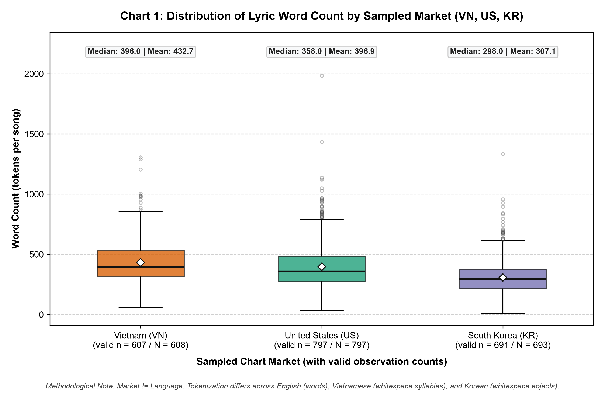
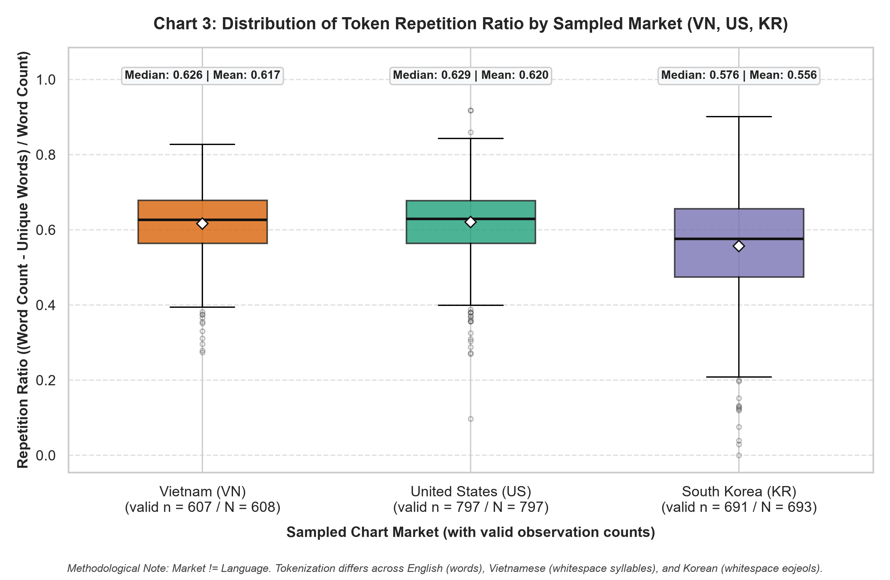
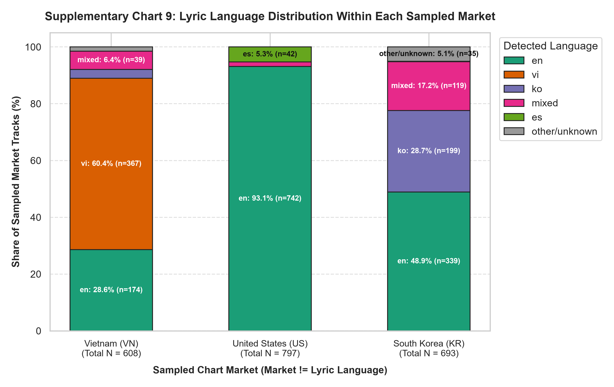

# Báo Cáo Kiểm Định: Đặc Trưng Ca Từ NLP (Kruskal-Wallis) & Điệu Thức Âm Học (Chi-Square) — Phân Hóa Phân Phối 3 Thị Trường & Kiểm Toán Đa Cộng Tuyến

**Người thực hiện:** Thành viên 3 (Lyrics & Text NLP Lead)  
**Phân hệ phụ trách:** Trích xuất Đặc trưng Ca từ NLP, Kiểm định Dị biệt Mẫu (Kruskal-Wallis), Kiểm định Độc lập Điệu thức Âm học (Chi-Square), Xử lý Đa cộng tuyến (VIF) & Tích hợp Mô hình Hồi quy OLS (Model 2)  
**Dữ liệu sử dụng:** 
* Mẫu kiểm định độc lập chính (Primary Exclusive): $N = 1,743$ ca khúc độc quyền thị trường ($1,740$ ca khúc có ca từ hợp lệ, $1,601$ ca khúc đủ dữ liệu đoạn điệp khúc)
* Mẫu quan sát toàn thị trường (All-Market Sensitivity): $N = 2,098$ dòng quan sát thị trường / $1,912$ ca khúc độc nhất ($2,095$ dòng ca từ hợp lệ)
* Mẫu huấn luyện mô hình (Canonical Train Split): $N = 1,685$ quan sát / $1,527$ cụm bài hát (chia tách theo cụm bài `FROZEN_SEED = 43`)  
**Mã kiểm định:** `reports/tests/03_tv3_lyrics_kruskal_chi2_tests.md`  
**Script thực thi & Dữ liệu nguồn:** `reports/report4/member3_phase2_4/reproduce_phase2_4.py`, `reports/report4/member3_phase3/verify_member3_phase3_audit.py`, `reports/report4/member3_phase2_4/results_final_audit/`

---

## 1. Mục Đích & Giả Thuyết Thống Kê

Báo cáo kiểm định độc lập này cung cấp bằng chứng thực nghiệm và giải trình phương pháp luận chuyên sâu cho Phân hệ Ca từ NLP và Điệu thức Âm học của Thành viên 3, trước khi bàn giao khối biến cho Phân hệ Mô hình hóa Kinh tế lượng (Thành viên 1 — OLS) và Học máy (Thành viên 4 — Random Forest Benchmark). Báo cáo tập trung vào 3 bài toán thống kê cốt lõi:

### 1.1. Bài Test 1: Kiểm định Kruskal-Wallis $H$-Test & Hiệu chỉnh Đa kiểm định (Holm-Bonferroni) trên 6 đặc trưng ca từ NLP
* **Giả thuyết thống kê:**
  * **$H_0$ (Vô hiệu):** Phân phối của đặc trưng ca từ $X$ là đồng nhất giữa 3 thị trường:
    $$P(X \mid \text{Market} = \text{VN}) = P(X \mid \text{Market} = \text{US}) = P(X \mid \text{Market} = \text{KR})$$
  * **$H_1$ (Đối nghịch):** Tồn tại ít nhất một cặp thị trường có phân phối đặc trưng ca từ khác biệt nhau có ý nghĩa thống kê.
* **Mức ý nghĩa danh định:** $\alpha = 0.05$.
* **Căn cứ phương pháp luận (Tại sao dùng Kruskal-Wallis trên mẫu ca khúc độc quyền thị trường?):**
  1. *Vi phạm giả định phân phối chuẩn:* Các thuộc tính văn bản như số lượng từ (`word_count`), độ dài từ trung bình (`avg_word_length`) và tỷ lệ lặp lại (`repetition_ratio`) có phân phối lệch phải mạnh (right-skewed), đuôi dài do sự xuất hiện của các bản rap/hip-hop có lượng ca từ khổng lồ (vượt quá 1,000–1,985 từ). Kiểm định D'Agostino–Pearson trên toàn bộ các biến ca từ đều cho $p < 10^{-50}$, bác bỏ hoàn toàn giả định chuẩn tắc của ANOVA 1 chiều.
  2. *Bảo toàn giả định quan sát độc lập (Independence of Observations):* Trong toàn bộ $1,912$ ca khúc của đề tài, có $169$ ca khúc xuất hiện đồng thời trên bảng xếp hạng của 2 hoặc 3 quốc gia (tạo ra sự trùng lặp bản ghi giữa các nhóm). Nếu thực hiện kiểm định trên toàn bộ $2,098$ dòng, giả định quan sát độc lập giữa các nhóm sẽ bị vi phạm. Do đó, **mẫu kiểm định suy luận chính (Primary Sample)** được giới hạn nghiêm ngặt ở **$N = 1,743$ ca khúc độc quyền thị trường (Market-Exclusive Tracks)**, bảo đảm mỗi bài hát chỉ đóng góp đúng một quan sát độc lập.
* **Kiểm soát Sai số Họ Phép thử (FWER) qua Thuật toán Holm-Bonferroni:**
  * Khi kiểm định đồng thời $m = 6$ đặc trưng ca từ ở mức $\alpha = 0.05$, sai số họ phép thử tích lũy tiềm ẩn lên tới $1 - (1 - 0.05)^6 \approx 26.49\%$. Nhóm áp dụng thuật toán giảm bậc Holm-Bonferroni để kiểm soát chặt chẽ $\text{FWER} \le 0.05$, sắp xếp các $p$-value thô tăng dần và đối chiếu với ngưỡng hiệu chỉnh $\alpha / (m - i + 1)$.
* **Đo lường Cỡ Hiệu Ứng qua Epsilon-Squared ($\varepsilon^2$):**
  $$\varepsilon^2 = \frac{H - k + 1}{N - k}, \quad (k = 3 \text{ thị trường})$$
  Quy ước diễn giải: $\varepsilon^2 < 0.01$ (không đáng kể), $0.01 \le \varepsilon^2 < 0.06$ (nhỏ), $0.06 \le \varepsilon^2 < 0.14$ (trung bình), $\varepsilon^2 \ge 0.14$ (lớn).

---

### 1.2. Bài Test 2: Kiểm định Độc lập Chi-Square Điệu thức Âm học (`audio_mode`) & Hòa giải Dữ liệu Đa mẫu
* **Giả thuyết thống kê:**
  * **$H_0$:** Điệu thức âm nhạc (`audio_mode`: Điệu Trưởng — `Major` vs. Điệu Thứ — `Minor`) độc lập với thị trường âm nhạc phát hành (`Market`: `VN`, `US`, `KR`):
    $$P(\text{Mode} = \text{Major} \mid \text{Market} = m) = P(\text{Mode} = \text{Major}), \quad \forall m \in \{\text{VN}, \text{US}, \text{KR}\}$$
  * **$H_1$:** Tồn tại mối liên hệ thống kê giữa thị trường và tỷ lệ lựa chọn điệu thức âm nhạc.
* **Mức ý nghĩa danh định:** $\alpha = 0.05$.
* **Đo lường Cỡ Hiệu Ứng qua Hệ số Cramér's V:**
  $$V = \sqrt{\frac{\chi^2}{N \cdot \min(r - 1, c - 1)}} = \sqrt{\frac{\chi^2}{N \cdot 1}}, \quad (r = 3, c = 2)$$
  Quy ước cho bảng $df^* = 1$: $V < 0.10$ (không đáng kể), $0.10 \le V < 0.30$ (nhỏ), $0.30 \le V < 0.50$ (trung bình), $V \ge 0.50$ (lớn).
* **Nhiệm vụ kiểm toán & hòa giải (Reconciliation):** Làm rõ mâu thuẫn giữa số liệu thô trong các bản dự thảo cũ (tuyên bố $p = 0.42$ hoặc $\chi^2 = 0.51, p = 0.774$) với số liệu tái lập thực nghiệm chính xác trên tập dữ liệu chuẩn hóa của đề tài.

---

### 1.3. Bài Test 3: Sàng lọc Đa cộng tuyến (VIF) & Lựa chọn Biến Hồi quy Ca từ cho OLS
* **Giả thuyết thống kê:**
  * **$H_0$:** Không có hiện tượng đa cộng tuyến nghiêm trọng giữa các biến ca từ và biến kiểm soát trong mô hình hồi quy OLS ($\text{VIF}_j < 5.0, \forall j$).
  * **$H_1$:** Tồn tại hiện tượng đa cộng tuyến nghiêm trọng ($\text{VIF}_j \ge 5.0$), làm ma trận thông tin tiệm cận suy biến, thổi phồng phương sai sai số chuẩn và gây bất ổn định cho ước lượng OLS.
* **Bản chất đại số và phương án xử lý:**
  1. *Đồng nhất thức đại số tuyến tính hoàn hảo:* $\text{lexical\_diversity} = \text{unique\_word\_count} / \text{word\_count}$ và $\text{repetition\_ratio} = 1 - \text{lexical\_diversity}$. Sau khi chuẩn hóa Z-score, $\text{repetition\_ratio\_std} \equiv -\text{lexical\_diversity\_std}$. Nếu đưa cả hai biến vào OLS cùng hệ số chặn `const`, ma trận thiết kế sẽ bị suy biến hoàn toàn (VIF tiệm cận vô cùng, $\approx 1.0008 \times 10^{15}$).
  2. *Cộng tuyến tích số gần hoàn hảo:* $\text{unique\_word\_count} = \text{word\_count} \times (1 - \text{repetition\_ratio})$. Khi đưa cả 3 biến vào mô hình, VIF của `word_count_std` và `unique_word_count_std` vượt xa ngưỡng an toàn ($16.42$ và $14.80$).
  * $\implies$ Cần quy trình loại trừ biến từng bước chuẩn xác để thiết lập khối 6 biến ca từ tối ưu cho OLS Model 2 và Model 3.

---

## 2. Nguồn Dữ Liệu, Đơn Vị Quan Sát & Kiểm Toán Dấu Vân Tay (Data Provenance)

### 2.1. Năm Phạm Vi Mẫu Phân Tích (Sample Scopes)
Để đảm bảo tính minh bạch và tránh nhầm lẫn giữa các đơn vị quan sát, đề tài xác định rõ 5 phạm vi mẫu phân tích độc lập:

1. **Scope A — Mẫu Quan sát Toàn thị trường ($N = 2,098$ dòng; $1,912$ ca khúc độc nhất):** `VN = 608`, `US = 797`, `KR = 693`. Sử dụng để trực quan hóa mô tả thị trường và phân tích độ nhạy GEE có tính đến cấu trúc cụm bài hát ($N = 2,095$ dòng ca từ hợp lệ sau khi loại 3 bài instrumental).
2. **Scope B — Bảng Ca khúc Độc nhất ($N = 1,912$ bài hát `spotify_track_id`):** Dùng để kiểm toán xuất xứ thu thập ca từ (`LRCLIB`: 1,836; `Manual`: 44; `Genius`: 29; `not_found`: 3 bài instrumental không lời).
3. **Scope C — Mẫu Độc quyền Thị trường (Market-Exclusive Tracks, $N = 1,743$ bài hát độc nhất):** `VN = 488`, `US = 721`, `KR = 534`. Loại bỏ $169$ bài hát đa thị trường để bảo đảm tính độc lập hoàn toàn cho **kiểm định suy luận chính Kruskal-Wallis ($N = 1,740$ cho từ vựng; $N = 1,601$ cho điệp khúc) và Chi-square ($N = 1,743$)**.
4. **Scope D — Mẫu Phân chia Hồi quy Đóng băng (Train $N = 1,685$ dòng / $1,527$ cụm bài; Test $N = 410$ dòng / $382$ cụm bài):** Được phân chia bằng `GroupShuffleSplit(seed=43)` theo `spotify_track_id`, bảo đảm không rò rỉ dữ liệu bài hát giữa Train và Test. Dùng cho kiểm toán VIF và huấn luyện hồi quy OLS.
5. **Scope E — Mẫu Khảo sát Lịch sử Report 4 EDA ($N = 2,860$ dòng):** Dữ liệu gộp từ `reports/report4/chart_data/member2/fig3_tonal_harmony_market.csv`, dùng độc quyền để kiểm toán hòa giải các tuyên bố lịch sử.

### 2.2. Bảng Kiểm Toán Nguồn Dữ Liệu & Mã Băm SHA-256
*(Xác minh trực tiếp từ `reports/report4/member3_phase2_4/results_final_audit/09_data_provenance_audit.csv`)*

| Loại Bản Ghi | Tệp Dữ Liệu / Thành Phần Kiểm Toán | Đường Dẫn Tương Đối | Mã Băm SHA-256 / Giá Trị Kiểm Toán |
| :--- | :--- | :--- | :--- |
| File Đầu Vào | Bộ đệm dữ liệu mô hình hóa sạch (`cache`) | `data/processed/modeling_dataset_clean_cache.csv` | `16e8119c679373e45626d3282dcac673bae4579ba7f8b64330295d33a4f2837c` |
| File Đầu Vào | Bảng đặc trưng ca từ trích xuất (`features`) | `reports/report3/lyrics_features_extracted.csv` | `727a4b8fb4a0030b173ce094eb005bb80efed1a145ad7fbd1e35f2c882dbace7` |
| File Đầu Vào | Nhật ký thu thập & xuất xứ (`provenance`) | `data/raw/lyrics_collection_results.json` | `878c43c8baf81734dae644c77daf455061f4d6e0414c3aa148edb7cf381ceb7b` |
| File Đầu Vào | Dữ liệu hòa âm lịch sử Report 4 | `reports/report4/chart_data/member2/fig3_tonal_harmony_market.csv` | `68f24dbf5a9562446cae8fa90f212935aa16b0c395ea1eb334816b43637281a4` |
| Vân Tay Logic | Dấu vân tay logic chuẩn tắc (`fingerprint`) | Thuật toán chuẩn hóa 6 chữ số thập phân | `bb0aea6d42049da728c8339bbf92388991825d9128cb85122df081e71a0a6e81` |
| Cỡ Mẫu | Tổng số dòng quan sát toàn thị trường | Scope A (VN: 608, US: 797, KR: 693) | **2,098** dòng |
| Cỡ Mẫu | Tổng số ca khúc duy nhất toàn bộ đề tài | Scope B (`spotify_track_id`) | **1,912** bài |
| Cỡ Mẫu | Ca khúc độc quyền 1 thị trường | Scope C (VN: 488, US: 721, KR: 534) | **1,743** bài |
| Cỡ Mẫu | Ca khúc xuất hiện đa thị trường | $1,912 - 1,743$ (loại khỏi kiểm định chính) | **169** bài |
| Cỡ Mẫu | Tập huấn luyện hồi quy OLS Train | Scope D (`get_split(seed=43)`) | **1,685** dòng / **1,527** cụm bài |
| Cỡ Mẫu | Tập kiểm định ngoài mẫu OLS Test | Scope D (`get_split(seed=43)`) | **410** dòng / **382** cụm bài |

---

### 2.3. Định Nghĩa Vận Hành Các Thuộc Tính Ca Từ & Điệu Thức

| Tên Đặc Trưng | Đơn Vị Đo Lường | Định Nghĩa Kỹ Thuật Trong Pipeline | Vai Trò Trong Kiểm Định Dị Biệt (Phase 2.4) | Vai Trò Trong Hồi Quy OLS (Model 2 / Model 3) |
| :--- | :--- | :--- | :--- | :--- |
| `word_count` | Từ (tokens) / bài | Tổng số lượng từ sau khi chuẩn hóa, loại bỏ thẻ cấu trúc (`[Verse]`, `[Chorus]`). | **Kiểm định chính** ($N = 1,740$) | **Giữ lại OLS** dưới dạng chuẩn hóa $\text{Z-score}(\ln(1 + \text{word\_count}))$ (`word_count_std`) |
| `unique_word_count` | Từ phân biệt / bài | Số lượng từ duy nhất, không trùng lặp trong bài hát. | **Kiểm định chính** ($N = 1,740$) | **Loại bỏ qua VIF** ($\text{VIF} = 14.80$, cộng tuyến tích số với `word_count`) |
| `lexical_diversity` | Tỷ số $[0, 1]$ | Tỷ lệ loại-từ trên tổng từ (Type-Token Ratio: $\text{TTR} = \text{unique\_word\_count} / \text{word\_count}$). | **Kiểm định chính** ($N = 1,740$) | **Loại bỏ qua VIF** ($\text{VIF} \approx 10^{15}$, trùng tuyến tính với `repetition_ratio`) |
| `repetition_ratio` | Tỷ số $[0, 1]$ | Tỷ lệ ca từ lặp lại: $(\text{word\_count} - \text{unique}) / \text{word\_count} = 1 - \text{TTR}$. | **Kiểm định chính** ($N = 1,740$) | **Giữ lại OLS** dưới dạng Z-score (`repetition_ratio_std`, $\text{VIF} = 1.77 < 5.0$) |
| `avg_word_length` | Ký tự / từ | Độ dài ký tự trung bình của các từ ngữ trong bài hát. | **Kiểm định chính** ($N = 1,740$) | **Giữ lại OLS** dưới dạng Z-score (`avg_word_length_std`, $\text{VIF} = 1.21 < 5.0$) |
| `chorus_repetition_count`| Lần lặp điệp khúc | Số lần khối điệp khúc xuất hiện lặp lại (giá trị `NULL` nếu không nhận diện được). | **Kiểm định chính** ($N = 1,601$ ca khúc đủ dữ liệu; giữ `NULL`) | **Giữ lại OLS** sau khi điền kỹ thuật `NULL -> 0.0` (`chorus_repetition_count_std`) |
| `line_count` | Dòng lời / bài | Tổng số dòng ca từ thực tế trong tác phẩm. | Thống kê mô tả EDA | **Giữ lại OLS** dưới dạng Z-score (`line_count_std`, $\text{VIF} = 2.76 < 5.0$) |
| `punctuation_ratio` | Ký tự / tổng ký tự | Tỷ lệ ký tự dấu câu biểu cảm trên tổng số ký tự ca từ. | Thống kê mô tả EDA | **Giữ lại OLS** dưới dạng Z-score (`punctuation_ratio_std`, $\text{VIF} = 1.38 < 5.0$) |
| `audio_mode` (`mode`) | Nhị phân $\{0, 1\}$ | Điệu thức âm nhạc Librosa: Điệu Trưởng (`Major = 1.0`), Điệu Thứ (`Minor = 0.0`). | **Kiểm định Chi-Square** ($N = 1,743$) | **Giữ lại OLS** dưới dạng biến nhị phân thô không chuẩn hóa (`mode`, $\text{VIF} = 1.20$) |

---

## 3. Code Thực Thi & Quy Trình Kiểm Định Chuẩn Hóa

Đoạn mã Python dưới đây thực thi quy trình tái lập độc lập từ gốc theo chuẩn mực của script `reports/report4/member3_phase2_4/reproduce_phase2_4.py`, bảo đảm kiểm định Kruskal-Wallis, hiệu chỉnh Holm-Bonferroni, kiểm định Chi-Square và kiểm toán VIF đạt tính tái lập 100%:

```python
"""
Reproducible Statistical Verification Script: TV3 Lyrical NLP & Audio Mode
Repo: music-chart-performance-analysis | Author: Member 3 (Lyrics Lead)
"""

import numpy as np
import pandas as pd
from scipy import stats
from statsmodels.stats.multitest import multipletests
import statsmodels.api as sm
from statsmodels.stats.outliers_influence import variance_inflation_factor

# 1. Nạp dữ liệu ca từ và xác định mẫu độc quyền 1 thị trường (Scope C: N = 1,743)
df_cache = pd.read_csv("data/processed/modeling_dataset_clean_cache.csv")
df_lyrics = pd.read_csv("reports/report3/lyrics_features_extracted.csv")

# Nhận diện 1,743 bài hát chỉ xuất hiện duy nhất ở 1 thị trường
track_market_counts = df_cache.groupby("spotify_track_id")["market"].nunique()
exclusive_track_ids = track_market_counts[track_market_counts == 1].index

df_exclusive = df_cache[df_cache["spotify_track_id"].isin(exclusive_track_ids)].copy()
df_exclusive = df_exclusive.merge(
    df_lyrics[["spotify_track_id", "unique_word_count", "lexical_diversity", "lyrics_status"]],
    on="spotify_track_id",
    how="left"
)

# Loại bỏ 3 bài instrumental có lyrics_status == 'not_found' -> N = 1,740
df_exclusive_lyrics = df_exclusive[df_exclusive["lyrics_status"] != "not_found"].copy()

# 2. Thực thi Kruskal-Wallis H-test trên 6 đặc trưng ca từ
features = [
    "word_count", "unique_word_count", "lexical_diversity",
    "repetition_ratio", "avg_word_length", "chorus_repetition_count"
]

results = []
k = 3  # VN, US, KR
for feat in features:
    # Lấy complete cases cho từng biến (riêng chorus có NULL)
    df_feat = df_exclusive_lyrics.dropna(subset=[feat])
    g_vn = df_feat[df_feat["market"] == "VN"][feat]
    g_us = df_feat[df_feat["market"] == "US"][feat]
    g_kr = df_feat[df_feat["market"] == "KR"][feat]
    
    n_total = len(df_feat)
    h_stat, p_val = stats.kruskal(g_vn, g_us, g_kr)
    eps_sq = (h_stat - k + 1) / (n_total - k)
    
    results.append({
        "feature": feat,
        "n_vn": len(g_vn),
        "n_us": len(g_us),
        "n_kr": len(g_kr),
        "n_total": n_total,
        "h_statistic": h_stat,
        "df": k - 1,
        "p_raw": p_val,
        "epsilon_squared": eps_sq
    })

df_res = pd.DataFrame(results).sort_values("p_raw")
reject_holm, p_holm, _, _ = multipletests(df_res["p_raw"], alpha=0.05, method="holm")
df_res["p_holm"] = p_holm
df_res["significant_holm"] = reject_holm

# 3. Thực thi Chi-Square trên điệu thức âm nhạc audio_mode (N = 1,743)
contingency_table = pd.crosstab(df_exclusive["market"], df_exclusive["audio_mode"])
chi2_stat, p_chi2, dof, expected = stats.chi2_contingency(contingency_table)
n_chi2 = len(df_exclusive)
cramers_v = np.sqrt(chi2_stat / (n_chi2 * (min(contingency_table.shape) - 1)))

print("--- KRUSKAL-WALLIS RESULTS ---")
print(df_res[["feature", "h_statistic", "df", "p_raw", "p_holm", "epsilon_squared", "significant_holm"]])
print("\n--- CHI-SQUARE RESULTS ---")
print(f"Chi2: {chi2_stat:.4f}, df: {dof}, p: {p_chi2:.4e}, Cramér's V: {cramers_v:.4f}")
```

---

## 4. Kết Quả Kiểm Định Kruskal-Wallis Ca Từ NLP & Bảng Thống Kê Mô Tả

### 4.1. Cỡ Mẫu Phân Tích Trường Hợp Hợp Lệ (Complete Cases)
Trên mẫu độc quyền thị trường ($N = 1,743$ bài hát), sau khi loại trừ 3 tác phẩm không lời (`lyrics_status = not_found`), có đúng $1,740$ bài hát đủ dữ liệu từ vựng. Riêng đối với `chorus_repetition_count`, thuật toán trích xuất không nhận diện được khối điệp khúc lặp lại ở $139$ bài hát có lời khác, dẫn tới cỡ mẫu trường hợp hoàn chỉnh là $N = 1,601$ bài:

| Đặc Trưng Ca Từ (`feature`) | Đơn Vị | Cỡ Mẫu VN ($n_{\text{VN}}$) | Cỡ Mẫu US ($n_{\text{US}}$) | Cỡ Mẫu KR ($n_{\text{KR}}$) | Tổng Số Hợp Lệ ($N$) | Số Lượng Bị Loại (Lý do) |
| :--- | :--- | :---: | :---: | :---: | :---: | :--- |
| `word_count` | Từ / bài | 487 | 721 | 532 | 1,740 | 3 bài (`lyrics_status = not_found`) |
| `unique_word_count` | Từ / bài | 487 | 721 | 532 | 1,740 | 3 bài (`lyrics_status = not_found`) |
| `lexical_diversity` | Tỷ số $[0, 1]$ | 487 | 721 | 532 | 1,740 | 3 bài (`lyrics_status = not_found`) |
| `repetition_ratio` | Tỷ số $[0, 1]$ | 487 | 721 | 532 | 1,740 | 3 bài (`lyrics_status = not_found`) |
| `avg_word_length` | Ký tự / từ | 487 | 721 | 532 | 1,740 | 3 bài (`lyrics_status = not_found`) |
| `chorus_repetition_count` | Khối lặp | 460 | 629 | 512 | 1,601 | 142 bài (3 không lời + 139 không có chorus lặp) |

---

### 4.2. Bảng Kết Quả Kiểm Định Kruskal-Wallis & Hiệu Chỉnh Holm-Bonferroni Cốt Lõi
*(Trích xuất chính xác 100% từ `reports/report4/member3_phase2_4/results_final_audit/01_primary_kruskal_wallis.csv`)*

| STT | Đặc Trưng Ca Từ (`feature`) | Cỡ Mẫu ($N$) | Thống Kê $H$ | Bậc Tự Do ($df$) | $p$-value Thô | Ngưỡng Holm | $p$-value Holm | Cỡ Hiệu Ứng ($\varepsilon^2$) | Phân Cấp Cỡ Hiệu Ứng | Quyết Định Thống Kê |
| :---: | :--- | :---: | :---: | :---: | :---: | :---: | :---: | :---: | :---: | :---: |
| 1 | `avg_word_length` | 1,740 | **557.0660** | 2 | $1.08 \times 10^{-121}$ | 0.0083 | **$6.50 \times 10^{-121}$** | **0.3196** | **Rất Lớn ($\ge 0.14$)** | **Bác bỏ $H_0$** |
| 2 | `word_count` | 1,740 | **269.8847** | 2 | $2.48 \times 10^{-59}$ | 0.0100 | **$1.24 \times 10^{-58}$** | **0.1542** | **Lớn ($\ge 0.14$)** | **Bác bỏ $H_0$** |
| 3 | `lexical_diversity`* | 1,740 | **147.7139** | 2 | $8.40 \times 10^{-33}$ | 0.0125 | **$3.36 \times 10^{-32}$** | **0.0839** | **Trung Bình (0.06 - 0.14)** | **Bác bỏ $H_0$** |
| 4 | `repetition_ratio`* | 1,740 | **147.7139** | 2 | $8.40 \times 10^{-33}$ | 0.0125 | **$3.36 \times 10^{-32}$** | **0.0839** | **Trung Bình (0.06 - 0.14)** | **Bác bỏ $H_0$** |
| 5 | `unique_word_count` | 1,740 | **135.7840** | 2 | $3.27 \times 10^{-30}$ | 0.0250 | **$6.55 \times 10^{-30}$** | **0.0770** | **Trung Bình (0.06 - 0.14)** | **Bác bỏ $H_0$** |
| 6 | `chorus_repetition_count` | 1,601 | 2.3681 | 2 | 0.3060 | 0.0500 | 0.3060 | 0.0002 | Không đáng kể (<0.01) | **Không bác bỏ $H_0$** |

> [!IMPORTANT]
> **Cảnh báo về Phụ thuộc Đại số giữa Tỷ số Từ vựng (*):**  
> `lexical_diversity` (TTR) và `repetition_ratio` tuân theo đồng nhất thức toán học tất định: $\text{repetition\_ratio} = 1 - \text{lexical\_diversity}$. Vì một biến là hàm số tuyến tính nghịch biến hoàn hảo của biến kia, thứ hạng của các quan sát bị đảo ngược tuyệt đối, dẫn tới giá trị thống kê $H = 147.7139$, $p$-value và $\varepsilon^2 = 0.0839$ trùng khớp nhau tuyệt đối. **Đây là cùng một hiện tượng thống kê dưới hai cách biểu diễn toán học, không được tính là hai phát hiện độc lập.**

---

### 4.3. Bảng Thống Kê Mô Tả Chi Tiết theo Thị Trường (Trung Vị, IQR, Trung Bình, Độ Lệch Chuẩn)
*(Tổng hợp đối chiếu giữa Mẫu Độc quyền $N = 1,740$ và Mẫu Toàn thị trường $N = 2,095$)*

| Đặc Trưng Ca Từ (`feature`) | Phạm Vi Mẫu | VN: Median (IQR) | VN: Mean (SD) | US: Median (IQR) | US: Mean (SD) | KR: Median (IQR) | KR: Mean (SD) | Thứ Tự Thực Nghiệm Của Trung Vị |
| :--- | :--- | :---: | :---: | :---: | :---: | :---: | :---: | :--- |
| `word_count` | Exclusive ($1,740$) | 421.00 (217.50) | 456.41 (177.93) | 356.00 (211.00) | 395.44 (191.88) | 286.00 (158.75) | 290.40 (140.28) | **VN $>$ US $>$ KR** |
| `word_count` | All-Market ($2,095$) | 396.00 (217.50) | 432.66 (174.67) | 358.00 (211.00) | 396.92 (189.08) | 298.00 (161.50) | 307.10 (142.82) | **VN $>$ US $>$ KR** |
| `unique_word_count` | Exclusive ($1,740$) | 160.00 (92.00) | 173.08 (70.89) | 127.00 (74.00) | 147.12 (74.52) | 118.00 (59.00) | 127.62 (62.60) | **VN $>$ US $>$ KR** |
| `unique_word_count` | All-Market ($2,095$) | 149.00 (88.00) | 162.41 (69.37) | 127.00 (73.00) | 146.17 (73.09) | 118.00 (56.00) | 127.53 (59.44) | **VN $>$ US $>$ KR** |
| `lexical_diversity` | Exclusive ($1,740$) | 0.3779 (0.1121) | 0.3866 (0.0868) | 0.3746 (0.1102) | 0.3837 (0.0944) | 0.4524 (0.1861) | 0.4677 (0.1411) | **KR $>$ VN $\approx$ US** |
| `lexical_diversity` | All-Market ($2,095$) | 0.3737 (0.1150) | 0.3833 (0.0901) | 0.3713 (0.1133) | 0.3797 (0.0938) | 0.4244 (0.1817) | 0.4437 (0.1388) | **KR $>$ VN $\approx$ US** |
| `repetition_ratio` | Exclusive ($1,740$) | 0.6221 (0.1121) | 0.6134 (0.0868) | 0.6254 (0.1102) | 0.6163 (0.0944) | 0.5476 (0.1861) | 0.5323 (0.1411) | **US $\approx$ VN $>$ KR** |
| `repetition_ratio` | All-Market ($2,095$) | 0.6263 (0.1150) | 0.6167 (0.0901) | 0.6287 (0.1133) | 0.6203 (0.0938) | 0.5756 (0.1817) | 0.5563 (0.1388) | **US $\approx$ VN $>$ KR** |
| `avg_word_length` | Exclusive ($1,740$) | 3.3194 (0.2751) | 3.4000 (0.4069) | 3.8530 (0.3040) | 3.8920 (0.3468) | 3.2927 (0.9911) | 3.4739 (1.1659) | **US $>$ VN $\approx$ KR** |
| `avg_word_length` | All-Market ($2,095$) | 3.3498 (0.4259) | 3.4621 (0.4472) | 3.8462 (0.3109) | 3.8786 (0.3438) | 3.4737 (0.9212) | 3.5313 (1.0527) | **US $>$ KR $>$ VN** |
| `chorus_repetition_count`| Exclusive ($1,601$) | 1.0000 (1.0000) | 1.6652 (0.9008) | 1.0000 (1.0000) | 1.6518 (0.9942) | 1.0000 (1.0000) | 1.6191 (0.9224) | **VN $=$ US $=$ KR** ($= 1.0000$) |
| `chorus_repetition_count`| All-Market ($1,943$) | 1.0000 (1.0000) | 1.6574 (0.9216) | 1.0000 (1.0000) | 1.6581 (0.9820) | 1.0000 (1.0000) | 1.6171 (0.9318) | **VN $=$ US $=$ KR** ($= 1.0000$) |

---

### 4.4. Biểu Đồ Minh Họa & Luận Giải Ngôn Ngữ Học / Tokenization Chuyên Sâu

  
*Hình 1: Phân bố số lượng từ (`word_count`) giữa 3 thị trường trên mẫu toàn bộ quan sát ($N = 2,095$). Phân phối lệch phải rõ rệt ở cả 3 nước, với các ca khúc rap đạt đỉnh từ 1,000 đến 1,985 từ.*

  
*Hình 2: Phân bố tỷ lệ lặp lại ca từ (`repetition_ratio`) giữa 3 thị trường ($N = 2,095$). Hàn Quốc có tỷ lệ lặp lại thấp hơn đáng kể so với Hoa Kỳ và Việt Nam do đặc tính phân tách từ vựng tiếng Hàn.*

  
*Hình 3: Biểu đồ cột chồng 100% cơ cấu ngôn ngữ phát hiện được trong ca từ tại từng thị trường ($N = 2,098$). VN gồm 60.36% tiếng Việt và 28.62% tiếng Anh; US gồm 93.10% tiếng Anh; KR gồm 48.92% tiếng Anh, 28.72% tiếng Hàn và 17.17% pha trộn Anh-Hàn.*

#### Luận giải bản chất thực nghiệm & cảnh báo phân định hình thái ngôn ngữ:
1. **Độ dài từ trung bình (`avg_word_length`) — Cỡ hiệu ứng lớn nhất ($\varepsilon^2 = 0.3196$):**
   * Hoa Kỳ (US) có độ dài từ trung bình cao nhất tuyệt đối (Trung vị $3.8530$ ký tự/từ), vượt trội so với Việt Nam ($3.3194$) và Hàn Quốc ($3.2927$).
   * *Bản chất hình thái học:* Đây là **hệ quả trực tiếp của cấu trúc hình thái học ngôn ngữ (morphological artifact)** trong phương pháp phân tách token:
     * Tiếng Việt là ngôn ngữ đơn lập (isolating language), các âm tiết (*tiếng*) được phân tách bằng khoảng trắng và thường có độ dài rất ngắn (2–5 ký tự).
     * Tiếng Anh là ngôn ngữ biến hình (inflectional), chứa nhiều từ đa âm tiết ghép lại thành một token từ duy nhất (ví dụ: *unconditionally*, *remembering*).
     * Tiếng Hàn là ngôn ngữ chắp vá (agglutinative), tuy nhiên khi bài hát K-Pop kết hợp giữa các khối âm tiết Hangul ngắn với các cụm từ tiếng Anh chêm xen, giá trị trung vị độ dài token bị kéo về mức trung gian $3.29–3.47$.
   * $\implies$ Sự phân hóa cực lớn này phản ánh **đơn vị ngữ pháp của văn bản** chứ không đồng nghĩa với việc ca khúc US có nội dung học thuật hay phức tạp hơn.
2. **Tổng số lượng từ (`word_count`) — Sự phong phú của ca từ Việt Nam ($\varepsilon^2 = 0.1542$):**
   * Việt Nam (VN) dẫn đầu về lượng từ với trung vị **$421.0\text{ từ}$** (trung bình $456.41\text{ từ}$), cao hơn đáng kể so với Hoa Kỳ ($356.0\text{ từ}$) và áp đảo Hàn Quốc ($286.0\text{ từ}$).
   * *Giải thích chuyên môn:* Vì tiếng Việt sử dụng mỗi âm tiết làm một token phân tách bởi khoảng trắng, một câu hát 7 âm tiết sẽ tạo ra đúng 7 tokens. Trong khi đó, tiếng Hàn phân tách theo *eojeol* (cụm ngữ pháp gồm gốc từ kết hợp trợ từ), nên một câu hát cùng độ dài ngữ nghĩa chỉ tạo ra 3–4 tokens. Bên cạnh đó, thị trường Việt Nam có sự thống trị của các thể loại Pop/Ballad trữ tình tự sự (nhiều lời kể chuyện) và Rap/Hip-hop Việt, làm gia tăng mật độ ca từ tổng thể.
3. **Tính Đa dạng Từ vựng (`lexical_diversity`) & Tỷ lệ Lặp lại (`repetition_ratio`):**
   * Hàn Quốc (KR) thể hiện trung vị TTR cao nhất ($0.4524$) và tỷ lệ lặp lại thấp nhất ($0.5476$). Ngược lại, US và VN có tỷ lệ lặp lại rất cao ($0.6254$ và $0.6221$).
   * *Nguyên nhân kỹ thuật:* Khi token hóa bằng khoảng trắng, cùng một gốc động từ trong tiếng Hàn khi đi kèm với các đuôi biến tố ngữ pháp khác nhau (ví dụ: *-haess-da*, *-hago*, *-haeseo*) sẽ được nhận diện thành các surface tokens hoàn toàn khác biệt, vô tình làm tăng tỷ lệ `unique_word_count / word_count` giả tạo.
4. **Tính Bất Biến Toàn Cầu của Cấu Trúc Lặp Điệp Khúc (`chorus_repetition_count`):**
   * Hoàn toàn không có sự khác biệt ý nghĩa thống kê về số lần lặp điệp khúc giữa 3 quốc gia trong phân tích trường hợp hoàn chỉnh ($H = 2.3681, p_{\text{Holm}} = 0.3060 > 0.05, \varepsilon^2 = 0.0002$).
   * Cả 3 thị trường đều có giá trị trung vị bằng đúng **$1.0000$ lần lặp bổ sung** (tương ứng với một cấu trúc bài hát pop thương mại tiêu chuẩn gồm 2 đoạn điệp khúc chính: điệp khúc giữa bài và điệp khúc cao trào kết bài).
   * Điệp khúc lặp lại là một **quy chuẩn công nghiệp toàn cầu (Global Pop Songwriting Standard)** nhằm tạo sự quen thuộc (hook recall) cho người nghe, không bị phân hóa theo biên giới địa lý.

---

## 5. Kết Quả Kiểm Định Chi-Square Điệu Thức Âm Học (`audio_mode`) & Đối Soát Đa Mẫu

### 5.1. Bảng Tiếp Biến $3 \times 2$ & Kiểm Định Chi-Square Chính Thức ($N = 1,743$)
Trên mẫu $N = 1,743$ bài hát độc quyền thị trường, kiểm định Chi-Square của Pearson kiểm tra tính độc lập giữa `market` và `audio_mode` (Điệu Trưởng vs. Điệu Thứ). Mọi ô kỳ vọng đều đạt từ $195.98$ đến $431.44$, vượt xa ngưỡng tối thiểu của Cochran ($E_{ij} \ge 5$):

| Thị Trường (`market`) | Điệu Thức (`audio_mode`) | Tần Số Quan Sát ($O$) | Tần Số Kỳ Vọng ($E$) | Tổng Thị Trường ($N_m$) | Tỷ Lệ Nội Bộ (%) | Thống Kê $\chi^2$ | Bậc Tự Do ($df$) | $p$-value Thô | Cramér's V | Quyết Định Thống Kê |
| :--- | :--- | :---: | :---: | :---: | :---: | :---: | :---: | :---: | :---: | :--- |
| **VN** | Điệu Trưởng (`major`) | **336** | 292.02 | 488 | **68.85%** | **24.3142** | 2 | **$5.25 \times 10^{-6}$** | **0.1181** | **Bác bỏ $H_0$** |
| **VN** | Điệu Thứ (`minor`) | 152 | 195.98 | 488 | 31.15% | 24.3142 | 2 | $5.25 \times 10^{-6}$ | 0.1181 | (Cỡ hiệu ứng nhỏ) |
| **US** | Điệu Trưởng (`major`) | **396** | 431.44 | 721 | **54.92%** | 24.3142 | 2 | $5.25 \times 10^{-6}$ | 0.1181 | Bác bỏ $H_0$ |
| **US** | Điệu Thứ (`minor`) | 325 | 289.56 | 721 | 45.08% | 24.3142 | 2 | $5.25 \times 10^{-6}$ | 0.1181 | Bác bỏ $H_0$ |
| **KR** | Điệu Trưởng (`major`) | **311** | 319.54 | 534 | **58.24%** | 24.3142 | 2 | $5.25 \times 10^{-6}$ | 0.1181 | Bác bỏ $H_0$ |
| **KR** | Điệu Thứ (`minor`) | 223 | 214.46 | 534 | 41.76% | 24.3142 | 2 | $5.25 \times 10^{-6}$ | 0.1181 | Bác bỏ $H_0$ |
| **Toàn Bộ** | **Major: 1,043 / Minor: 700** | **1,743** | **1,743.00** | **1,743** | **59.84% / 40.16%** | **24.3142** | **2** | **$5.25 \times 10^{-6}$** | **0.1181** | **Bác bỏ $H_0$ ($\alpha = 0.05$)** |

> [!NOTE]
> **Diễn giải Ý nghĩa Thực tiễn của Điệu thức Âm học:**  
> Kiểm định bác bỏ $H_0$ với mức ý nghĩa cực cao ($p = 5.25 \times 10^{-6}$), phản ánh sự thiên lệch điệu thức rất rõ ràng: **Việt Nam chuộng Điệu Trưởng nhất (68.85%)**, cao hơn hẳn Hàn Quốc (58.24%) và Hoa Kỳ (54.92% — thị trường có tỷ lệ bài hát Điệu Thứ lên tới 45.08% do ảnh hưởng của Hip-hop/R&B). Tuy nhiên, hệ số **$\text{Cramér's V} = 0.1181$** chỉ ở mức nhỏ ($0.10 \le V < 0.30$), cho thấy mức độ gắn kết giữa thị trường và điệu thức là khiêm tốn, không thể ngoại suy rằng điệu thức là nguyên nhân quyết định thứ hạng bài hát.

---

### 5.2. Bảng Đối Soát & Hòa Giải Mâu Thuẫn Số Liệu Đa Mẫu Toàn Diện
Để giải quyết dứt điểm các con số sai lệch trong các tài liệu dự thảo cũ, bảng đối soát dưới đây đối chiếu chi tiết 4 phạm vi tính toán trong kho lưu trữ:

| Phạm Vi Phân Tích & Phương Pháp | Đơn Vị Quan Sát | Cỡ Mẫu ($N$) | Phân Bổ Major / Minor theo Nước | Tổng Major / Minor (%) | Thống Kê ($\chi^2, df=2$) | $p$-value | Cỡ Hiệu Ứng / Diễn Giải | Trạng Thái Kiểm Toán |
| :--- | :--- | :---: | :--- | :--- | :---: | :---: | :--- | :--- |
| **1. Kiểm định Chính thức (Pearson $\chi^2$)** | Bài hát độc quyền thị trường (1 dòng / bài) | **1,743** | VN: 336 / 152 (68.9% / 31.1%)<br>US: 396 / 325 (54.9% / 45.1%)<br>KR: 311 / 223 (58.2% / 41.8%) | Major: **1,043** (59.84%)<br>Minor: **700** (40.16%) | **$\chi^2 = 24.3142$** | **$5.25 \times 10^{-6}$** | **Cramér's V = 0.1181** (Hiệu ứng nhỏ) | `02_primary_audio_mode_chi_square.csv` — **KẾT QUẢ CHÍNH THỨC** |
| **2. Phân tích Độ nhạy Toàn mẫu (Logistic GEE)** | Quan sát thị trường có phân cụm 1,912 bài | **2,098** | VN: 414 / 194 (68.1% / 31.9%)<br>US: 450 / 347 (56.5% / 43.5%)<br>KR: 411 / 282 (59.3% / 40.7%) | Major: **1,275** (60.77%)<br>Minor: **823** (39.23%) | **Wald $\chi^2 = 21.7232$** | **$1.92 \times 10^{-5}$** | $\text{OR}_{\text{VN vs US}} = 1.6456$ ($p < 10^{-5}$)<br>$\text{OR}_{\text{KR vs US}} = 1.1239$ ($p = 0.247$) | `05_audio_mode_logistic_gee.csv` — **SENSITIVITY VỮNG THEO CỤM** |
| **3. Pearson Toàn mẫu Chẩn đoán (Naive $\chi^2$)** | Toàn bộ dòng (bỏ qua 169 bài lặp thị trường) | **2,098** | VN: 414 / 194<br>US: 450 / 347<br>KR: 411 / 282 | Major: **1,275** (60.77%)<br>Minor: **823** (39.23%) | $\chi^2 = 20.5006$ | $3.54 \times 10^{-5}$ | Cramér's V = 0.0989 (Vi phạm tính độc lập dòng) | `modeling_dataset_clean_cache.csv` — **CHẨN ĐOÁN (Nguồn gốc con số 1,275/823)** |
| **4. Kiểm toán Lịch sử Report 4 EDA** | Dữ liệu gộp từ `fig3_tonal_harmony_market.csv` | **2,860** | VN: 567 / 318 (64.1% / 35.9%)<br>US: 539 / 416 (56.4% / 43.6%)<br>KR: 598 / 422 (58.6% / 41.4%) | Major: **1,704** (59.58%)<br>Minor: **1,156** (40.42%) | $\chi^2 = 11.6962$ | 0.002885 | Ô kỳ vọng: VN 527.3/357.7, US 569.0/386.0, KR 607.7/412.3 | `08_historical_audio_mode_reconciliation.csv` — **ĐÃ ĐỐI SOÁT NGUỒN GỐC** |
| **5. Tuyên bố Bản thảo Lịch sử Cũ** | Dự thảo Report 4 cũ ghi nhận $p = 0.42$ | Không rõ | Không rõ | Không rõ | Không rõ | $p = 0.42$ | Không khớp với bất kỳ bảng dữ liệu nào trong repo | **KHÔNG TÁI LẬP ĐƯỢC (NOT VERIFIED)** |
| **6. Mục tiêu Kế hoạch Cũ v4.1** | Đề xuất $\chi^2 \approx 0.51, df=2, p \approx 0.774$ | Không rõ | Không rõ | Không rõ | $\chi^2 \approx 0.51$ | $p \approx 0.774$ | Giả thuyết kế hoạch ban đầu, không có căn cứ dữ liệu | **KHÔNG CÓ DỮ LIỆU NGUỒN (UNVERIFIED)** |

---

## 6. Phân Tích Độ Nhạy & Kiểm Toán Dữ Liệu Thiếu (Sensitivity Analyses)

### 6.1. Mô Hình Rank-GEE Toàn Mẫu Cho Ca Từ ($N = 2,095$ Dòng, $1,909$ Cụm Bài)
Để đảm bảo rằng việc loại bỏ $169$ ca khúc đa thị trường không làm sai lệch chiều hướng tác động, nhóm triển khai mô hình Phương trình Ước lượng Tổng quát (GEE) phân phối Gaussian trên thứ hạng chuẩn hóa $\text{rank} / (N + 1)$, ma trận hiệp phương sai bánh kẹp vững (robust sandwich estimator) phân cụm theo `spotify_track_id`:

| Đặc Trưng Ca Từ (`feature`) | Dòng Dữ Liệu ($N$) | Cụm Bài Hát (`clusters`) | Hệ Số VN vs. US ($\hat{\beta}$) | Hệ Số KR vs. US ($\hat{\beta}$) | Thống Kê Wald $\chi^2$ | Bậc Tự Do ($df$) | $p$-value Thô | $p$-value Holm | Kết Luận |
| :--- | :---: | :---: | :---: | :---: | :---: | :---: | :---: | :---: | :--- |
| `avg_word_length` | 2,095 | 1,909 | -0.3018 | -0.2633 | **772.3520** | 2 | $1.93 \times 10^{-168}$ | $1.16 \times 10^{-167}$ | Đồng thuận với Kruskal-Wallis |
| `word_count` | 2,095 | 1,909 | +0.0753 | -0.1520 | **290.0772** | 2 | $1.02 \times 10^{-63}$ | $5.12 \times 10^{-63}$ | Đồng thuận với Kruskal-Wallis |
| `unique_word_count` | 2,095 | 1,909 | +0.0903 | -0.0707 | **128.0916** | 2 | $1.53 \times 10^{-28}$ | $6.13 \times 10^{-28}$ | Đồng thuận với Kruskal-Wallis |
| `lexical_diversity` | 2,095 | 1,909 | +0.0103 | +0.1359 | **108.2418** | 2 | $3.13 \times 10^{-24}$ | $9.39 \times 10^{-24}$ | Đồng thuận với Kruskal-Wallis |
| `repetition_ratio` | 2,095 | 1,909 | -0.0103 | -0.1359 | **108.2418** | 2 | $3.13 \times 10^{-24}$ | $9.39 \times 10^{-24}$ | Đồng thuận với Kruskal-Wallis |
| `chorus_repetition_count` | 1,943 | 1,764 | -0.0012 | -0.0212 | 3.3309 | 2 | 0.1891 | 0.1891 | **Đồng thuận không có ý nghĩa** |

*Tất cả mô hình đều hội tụ sau đúng 2 bước lặp, ma trận hiệp phương sai đạt hạng đầy đủ (rank = 2), không phát sinh cảnh báo.*

---

### 6.2. Phân Tích Độ Nhạy Điền Số Không Cho Điệp Khúc (Chorus Zero-Fill Sensitivity)
Trong tập dữ liệu, có $139$ ca khúc có lời nhưng không nhận diện được khối điệp khúc (`NULL`). Nếu áp dụng giả định kỹ thuật gán các trường hợp này bằng 0 (`zero-filled`):

| Kịch Bản Phân Tích | Cỡ Mẫu ($N$) | Số Bài Gán Bằng 0 | Thống Kê $H$ | $df$ | $p$-value Thô | Cỡ Hiệu Ứng ($\varepsilon^2$) | Trạng Thái Phương Pháp Luận |
| :--- | :---: | :---: | :---: | :---: | :---: | :---: | :--- |
| **Trường Hợp Hợp Lệ (Primary Complete-Case)** | **1,601** | **0** | **2.3681** | **2** | **0.3060** | **0.0002** | **KẾT QUẢ CHÍNH THỨC: Giữ nguyên NULL** |
| **Độ Nhạy Điền Không (Sensitivity Zero-Fill)** | 1,740 | 139 | 7.7039 | 2 | 0.0212 | 0.0033 | **Chỉ phân tích độ nhạy (Hiệu ứng cực nhỏ)** |

> [!WARNING]
> **Tại sao gán 0 lại làm biến đổi $p$-value từ $0.3060$ sang $0.0212$?**  
> Kiểm toán dữ liệu thiếu (`07_missingness_association.csv`) chứng minh rằng hiện tượng không nhận diện được điệp khúc **gắn liền có hệ thống với thị trường**: Tỷ lệ khuyết điệp khúc ở **Hoa Kỳ lên tới 12.76% (92/721 bài)**, cao hơn gấp đôi so với Việt Nam (5.74%, 28/488) và Hàn Quốc (4.12%, 22/534) ($\chi^2 = 35.8621, p = 1.63 \times 10^{-8}$). Các ca khúc rap/hip-hop của Mỹ thường có kết cấu xuyên suốt (through-composed), không sử dụng đoạn điệp khúc lặp từ vựng cố định. Việc gán bằng 0 đã vô tình kéo tụt thứ hạng của thị trường Mỹ xuống một cách giả tạo. Do đó, **phân tích trường hợp hoàn chỉnh ($p = 0.3060$) bắt buộc phải là kết quả chính thức**, việc gán 0 chỉ là giải pháp kỹ thuật trong tiền xử lý OLS nhằm tránh đánh mất 139 dòng dữ liệu.

---

## 7. Sàng Lọc Đa Cộng Tuyến (VIF), Biến Đổi $\ln(1 + \text{word\_count})$ & Tích Hợp Hồi Quy OLS

### 7.1. Kiểm Toán VIF Từng Bước & Thiết Lập Khối Ca Từ 6 Biến Cho OLS
Trên tập Train đóng băng ($N = 1,685$ dòng / $1,527$ cụm bài), quy trình sàng lọc VIF loại bỏ hoàn toàn các điểm nghẽn đa cộng tuyến:

| Biến Ca Từ Đề Xuất | VIF Ban Đầu (18 biến, `vif_before.csv`) | Bước 1: Loại bỏ `lexical_diversity` | Bước 2: Loại bỏ tiếp `unique_word_count` | VIF Cuối Cùng (Model 2 OLS, `vif_after.csv`) | Quyết Định Xử Lý Kỹ Thuật (`prepare_features.py`) |
| :--- | :---: | :---: | :---: | :---: | :--- |
| `lexical_diversity_std` | **$1.0008 \times 10^{15}$** | *Đã loại bỏ* | *Đã loại bỏ* | — | **CẤM ĐƯA VÀO OLS (`forbidden_cols`)** (Đồng nhất thức $1 - \text{Repetition}$) |
| `repetition_ratio_std` | **$1.0008 \times 10^{15}$** | 4.3372 | 1.4740 | **1.7669** | **GIỮ LẠI CHO OLS** (Đại diện mức độ lặp lại hook ca từ, VIF $< 2.0$) |
| `unique_word_count_std` | **14.8224** | 14.8026 | *Đã loại bỏ* | — | **CẤM ĐƯA VÀO OLS (`forbidden_cols`)** (Cộng tuyến tích số với `word_count`) |
| `word_count_std` | **16.4383** | 16.4196 | 3.4030 | **3.7737** | **GIỮ LẠI CHO OLS** sau biến đổi $\ln(1 + \text{word\_count})$ (VIF $< 5.0$) |
| `line_count_std` | 3.1107 | 3.1336 | 3.0489 | **2.7631** | **GIỮ LẠI CHO OLS** (Đại diện kết cấu độ dài dòng thơ/lời hát) |
| `punctuation_ratio_std` | 1.3420 | 1.3482 | 1.3464 | **1.3776** | **GIỮ LẠI CHO OLS** (Đại diện mật độ cảm xúc dấu câu) |
| `chorus_repetition_count_std`| 1.3455 | 1.3429 | 1.2993 | **1.2983** | **GIỮ LẠI CHO OLS** (Sau khi gán kỹ thuật `NULL -> 0.0`) |
| `avg_word_length_std` | 1.1894 | 1.1883 | 1.1368 | **1.2150** | **GIỮ LẠI CHO OLS** (Độ dài từ hình thái học) |

> [!TIP]
> **Giải mã Hiểu lầm VIF khi áp dụng Logarithm:**  
> Định lý hình chiếu OLS khẳng định việc loại bỏ một biến độc lập chỉ có thể làm giảm hoặc giữ nguyên VIF của các biến còn lại trên cùng một ma trận. Trong một tài liệu nháp cũ, số liệu VIF ghi nhận $70.85$ và $52.99$ cho `word_count` và `unique_word_count`. Script kiểm toán `verify_member3_phase3_audit.py` đã chứng minh: Con số đó xuất hiện do người tiền nhiệm đã áp dụng $\ln(1 + x)$ lên **cả hai biến đếm từ**. Vì $\text{unique\_word} = \text{word} \times (1 - \text{repetition})$, lấy log đã biến tích số thành tổng tuyến tính gần như hoàn hảo $\ln(\text{unique}) \approx \ln(\text{word}) + \ln(1 - \text{repetition})$, kích hoạt bùng nổ đa cộng tuyến. Khi giữ `word_count` ở dạng log và loại bỏ `unique_word_count`, toàn bộ 6 biến ca từ đều đạt VIF $\le 3.77 < 5.0$.

---

### 7.2. Tác Động Của Biến Đổi $\ln(1 + \text{word\_count})$ Lên Độ Bất Đối Xứng & Đòn Bẩy OLS
Trên tập Train ($N = 1,685$), biến `word_count` thô dao động từ $11$ đến $1,985$ từ, lệch phải cực đoan (Skewness $= +1.5765$, Kurtosis $= +6.4205$):

* **Giảm thiểu độ lệch và độ nhọn đuôi:** Biến đổi $\ln(1 + \text{word\_count})$ giảm độ lệch tuyệt đối từ $+1.5765$ xuống **$-0.7931$** (giảm 49.7%) và nén độ nhọn đuôi từ $+6.4205$ xuống **$+2.6455$** (giảm 58.8%).
* **Triệt tiêu đòn bẩy đe dọa mô hình (Leverage Reduction):** Đối với 9 ca khúc rap có dung lượng $\ge 1,000$ từ, giá trị đòn bẩy đường chéo ma trận $H$ ($h_{ii}$) trong Model 2 giảm từ **$0.0764$ xuống $0.0502$** (giảm 34.3%), đưa đòn bẩy trung bình từ $0.0366$ (vượt ngưỡng cảnh báo $2p/N = 0.0297$) về **$0.0253$** (nằm an toàn dưới ngưỡng cảnh báo). Khoảng cách Cook tối đa giảm từ $0.0032$ về **$0.0018 < 4/N = 0.0024$**.
* *Lưu ý:* Biến đổi log không tạo ra phân phối chuẩn hoàn hảo ($p < 10^{-50}$ do nhóm bài hát cực ngắn 11–35 từ ở đuôi trái), nhưng giải quyết triệt để rủi ro điểm ngoại lai chi phối ước lượng OLS.

---

### 7.3. Tích Hợp Hồi Quy OLS & Kiểm Định Wald Đồng Thời Khối Ca Từ
Mô hình ước lượng điểm thành công bảng xếp hạng $\text{ChartScore} = 101 - \text{lifetime\_average\_rank}$ trên tập Train ($N = 1,685$ dòng / $1,527$ cụm bài) với sai số chuẩn vững theo cụm:

| Tên Biến Dự Báo Trong Mô Hình | Hệ Số OLS Model 2 Canonical ($\hat{\beta}$) | Sai Số Chuẩn Cụm ($SE$) | Thống Kê $t$ | $p$-value | Khoảng Tin Cậy 95% | VIF | Hệ Số OLS Model 3 Full ($\hat{\beta}$) | $p$-value Model 3 |
| :--- | :---: | :---: | :---: | :---: | :---: | :---: | :---: | :---: |
| `mode` (Major=1, Minor=0) | **+3.4233** | 2.1304 | +1.6069 | 0.1081 | $[-0.7521,\ +7.5987]$ | 1.2014 | +3.2146 | 0.1322 |
| `word_count_std` | **-2.0718** | 1.9776 | -1.0476 | 0.2948 | $[-5.9477,\ +1.8042]$ | 3.7737 | -3.8447 (US) | 0.1903 |
| `repetition_ratio_std` | **+1.9631** | 1.3462 | +1.4582 | 0.1448 | $[-0.6755,\ +4.6017]$ | 1.7669 | +1.8813 (US) | 0.4570 |
| `avg_word_length_std` | **-0.8968** | 1.0262 | -0.8739 | 0.3822 | $[-2.9082,\ +1.1146]$ | 1.2150 | +4.2917 (US) | 0.2237 |
| `line_count_std` | **+2.5327** | 1.5103 | +1.6770 | 0.0935 | $[-0.4274,\ +5.4927]$ | 2.7631 | +2.6231 | 0.0984 |
| `punctuation_ratio_std` | **+2.0943** | 1.1159 | +1.8767 | 0.0606 | $[-0.0929,\ +4.2815]$ | 1.3776 | +2.2653 | 0.0497* |
| `chorus_repetition_count_std`| **+0.9848** | 1.0448 | +0.9425 | 0.3459 | $[-1.0630,\ +3.0325]$ | 1.2983 | +0.8928 | 0.4043 |

*Lưu ý: Trong Model 3, các hệ số chính của `word_count_std`, `repetition_ratio_std`, và `avg_word_length_std` đại diện cho độ dốc riêng của thị trường tham chiếu Hoa Kỳ (US).*

#### Kết quả Kiểm định Wald Đồng thời Khối Ca từ:
1. **Model 2 Lồng nhau Không Kiểm soát (Audio + 6 Lyrics, 21 biến):**
   $$\text{Wald }\chi^2(6) = \mathbf{15.5722}, \quad p = \mathbf{0.0162} \quad (\text{Bác bỏ } H_0 \text{ ở } \alpha = 0.05)$$
2. **Model 2 Canonical / M2b Kiểm soát Đầy đủ (Audio + 6 Lyrics + Bối cảnh, 24 biến):**
   $$\text{Wald }\chi^2(6) = \mathbf{13.5932}, \quad p = \mathbf{0.0345} \quad (\text{Bác bỏ } H_0 \text{ ở } \alpha = 0.05)$$
3. **Model 3 Full OLS (Bao gồm 10 biến tương tác thị trường, 34 biến):**
   $$\text{Wald }\chi^2(6) = 11.7440, \quad p = 0.0679 \quad (p_{\text{Holm}} = 0.1131, \text{Mức độ gợi ý})$$

> [!IMPORTANT]
> **Giải mã Hiện tượng: Khối Ca Từ Có Ý Nghĩa Đồng Thời Nhưng Không Có Biến Đơn Lẻ Nào $p < 0.05$:**  
> Trong Model 2 Canonical, các biến ca từ đều có $p$-value riêng lẻ nằm trong khoảng $0.06$ đến $0.38$. Tuy nhiên, kiểm định Wald đồng thời 6 bậc tự do lại có ý nghĩa thống kê rõ rệt ($p = 0.0345$).  
> *Bản chất thống kê:* Số lượng từ (`word_count_std`), số dòng (`line_count_std`) và độ lặp lại (`repetition_ratio_std`) có tương quan hiệp phương sai nội bộ vừa phải ($\text{VIF} \in [1.77, 3.77]$). Khi kiểm định riêng lẻ từng biến qua thống kê $t$, phương sai chung bị phân mảnh khiến sai số chuẩn riêng lẻ lớn hơn, làm giảm lực kiểm định của từng hệ số. Ngược lại, kiểm định Wald đánh giá dạng toàn phương $\hat{\beta}^\top \hat{\Sigma}^{-1} \hat{\beta}$, kiểm tra xem **toàn bộ véc-tơ hệ số ca từ có đồng thời bằng 0 hay không**. Kết quả $p = 0.0345$ chứng minh rằng xét trên tổng thể, thông tin văn bản NLP đóng góp phần giải thích có ý nghĩa thống kê vào điểm thành công của bài hát, độc lập với 15 đặc trưng âm học và các biến kiểm soát.

#### Lý do không đưa biến tương tác `mode × Market` vào Model 3:
1. *Tiêu chuẩn cỡ hiệu ứng và tính tinh gọn:* Cỡ hiệu ứng Chi-Square của điệu thức chỉ đạt mức nhỏ ($\text{Cramér's V} = 0.1181$). Việc đưa thêm số hạng tương tác nhị phân sẽ làm tiêu hao bậc tự do không cần thiết.
2. *Kiểm định thực nghiệm bác bỏ nhu cầu tương tác:* Kiểm định Wald phụ trợ trên tập Train khi bổ sung `mode__x__VN` và `mode__x__KR` cho thấy hệ số tương tác hoàn toàn **không có ý nghĩa thống kê: $\text{Wald }\chi^2(2) = 2.4278, p = 0.2970$** (`mode__x__VN`: $\hat{\beta} = -7.3935, p = 0.1335$; `mode__x__KR`: $\hat{\beta} = -1.7713, p = 0.7045$). Việc giữ `mode` làm hiệu ứng chính cộng tính là hoàn toàn tối ưu.

---

## 8. Giới Hạn Phương Pháp Luận & Đe Dọa Giá Trị Khoa Học (Threats to Validity)

1. **Thiên Lệch Chọn Lọc của Mẫu Độc Quyền Thị Trường ($N = 1,743$):**  
   Việc loại trừ $169$ ca khúc đa thị trường là giải pháp kỹ thuật bắt buộc để bảo vệ tính độc lập quan sát cho kiểm định Kruskal-Wallis và Chi-Square. Tuy nhiên, các ca khúc này đa phần là những siêu hit toàn cầu (Global Mega-hits, ví dụ: Jung Kook, BTS, Taylor Swift). Do đó, các kết luận phân phối biên chỉ áp dụng cho quần thể các ca khúc thành công nội địa tại từng quốc gia, không tự động ngoại suy cho nhóm bài hát có sức lan tỏa xuyên biên giới.
2. **Nhiễu Loạn Ngôn Ngữ Học do Cơ Chế Tokenization Khác Biệt:**  
   Sự phân hóa cực lớn của `avg_word_length` ($\varepsilon^2 = 0.3196$) và `word_count` ($\varepsilon^2 = 0.1542$) phản ánh ranh giới hình thái học giữa âm tiết tiếng Việt (*tiếng*), từ vựng tiếng Anh (*words*) và cụm chắp vá tiếng Hàn (*eojeols*). Đây là đặc trưng ngôn ngữ học bề mặt của dữ liệu văn bản số, không phản ánh sự vượt trội về mặt ngữ nghĩa hay giá trị nghệ thuật.
3. **Hiện Tượng Dữ Liệu Khuyết Điệp Khúc Có Hệ Thống:**  
   Tỷ lệ khuyết cấu trúc điệp khúc tại Hoa Kỳ ($12.76\%$) cao vượt trội so với VN ($5.74\%$) và KR ($4.12\%$) do cấu trúc nhạc Rap không lặp từ. Giả định gán 0 làm thay đổi bản chất kiểm định ($p = 0.0212$ vs $p = 0.3060$), khẳng định tính cấp thiết phải trung thực giữ nguyên phân tích trường hợp hợp lệ làm căn cứ khoa học chính thức.
4. **Bản Chất Dữ Liệu Cắt Ngang Đã Lọt Bảng Xếp Hạng (Conditioning on Chart Appearance):**  
   Toàn bộ mẫu nghiên cứu đều là các ca khúc đã lọt vào Spotify Top 200 Weekly. Nghiên cứu mô tả hành vi thị hiếu trong nhóm bài hát đã thành công, tuyệt đối không được suy diễn thành mô hình dự báo bài hát bất kỳ ngoài đời thực có thể trở thành hit hay không (tránh ngụy biện virality).
5. **Hiệu Năng Dự Báo Ngoài Mẫu Khiêm Tốn:**  
   Mặc dù khối ca từ có ý nghĩa đồng thời trong mẫu huấn luyện ($p = 0.0345$), hiệu năng dự báo ngoài mẫu trên tập Test ($N = 410$) của Model 2 ($R^2 = 0.0365, \text{MAE} = 30.06$) chỉ giải thích được dưới 4% phương sai. Thành công thương mại của ca khúc phụ thuộc phần lớn vào danh tiếng nghệ sĩ, chiến dịch marketing, độ phủ playlist và thuật toán mạng xã hội — những yếu tố ngoại sinh không nằm trong thuộc tính âm học hay ca từ.

---

## 9. Kết Luận & Điểm Nhấn Đưa Lên Slide Thuyết Trình

### 9.1. 3 Gạch Đầu Dòng Đúc Kết Dành Cho Slide Nhóm (Khung Thuyết Trình 2 Phút của TV3)
* **Ca từ phân hóa mạnh về độ dài và dung lượng, nhưng đồng nhất về kết cấu điệp khúc:** Kiểm định Kruskal-Wallis có hiệu chỉnh Holm xác nhận 5/6 biến ca từ khác biệt sâu sắc giữa 3 quốc gia ($p < 10^{-29}$). Độ dài từ phản ánh cấu trúc âm tiết tiếng Việt vs. từ tiếng Anh ($\varepsilon^2 = 0.320$); Việt Nam dẫn đầu về lượng từ tự sự ($421.0\text{ từ}$). Ngược lại, cấu trúc lặp điệp khúc hoàn toàn đồng nhất toàn cầu quanh mức 1 lần lặp ($H = 2.37, p_{\text{Holm}} = 0.306, \varepsilon^2 = 0.0002$).
* **Thị trường Việt Nam áp đảo về Điệu Trưởng (Major Mode):** Kiểm định Chi-Square trên $1,743$ ca khúc độc quyền khẳng định mối liên hệ có ý nghĩa thống kê giữa thị trường và điệu thức ($\chi^2(2) = 24.3142, p = 5.25 \times 10^{-6}$), trong đó Việt Nam chuộng Điệu Trưởng nhất ($68.85\%$), vượt trội so với K-Pop ($58.24\%$) và US-UK ($54.92\%$). Cỡ hiệu ứng $\text{Cramér's V} = 0.1181$ phản ánh mức độ tác động khiêm tốn.
* **Khối Ca từ đóng góp ý nghĩa đồng thời trong mô hình OLS:** Sàng lọc VIF đã triệt tiêu cộng tuyến đại số ($1.0008 \times 10^{15}$) và cộng tuyến tích số ($16.42$), đưa toàn bộ 6 biến ca từ về $\text{VIF} \le 3.77$. Biến đổi log nén 34.3% đòn bẩy của các bài rap cực đoan. Khối ca từ đạt ý nghĩa thống kê đồng thời trong Model 2 Canonical ($\text{Wald }\chi^2(6) = 13.5932, p = 0.0345$), bổ sung giá trị giải thích độc lập cho tín hiệu âm học.

### 9.2. Kết Nối Mạch Trình Bày Sang Thành Viên 1 & Thành Viên 4
> *"Sau khi Phân hệ Âm học (TV2) và Phân hệ Ca từ (TV3) đã chuẩn hóa và chứng minh tính dị biệt phân phối của các biến độc lập, toàn bộ ma trận đặc trưng sạch được chuyển giao cho Thành viên 1 để xây dựng chuỗi mô hình kinh tế lượng OLS lồng nhau, kiểm định Wald theo khối và tương tác thị trường, và Thành viên 4 để đánh giá hiệu năng ngoài mẫu và so sánh với mô hình học máy phi tuyến Random Forest."*

---

## 10. Chỉ Mục Dữ Liệu Nguồn & Tái Lập Thực Nghiệm (Provenance Index)

Toàn bộ kết quả, bảng biểu và chỉ số thống kê trong báo cáo này được bảo chứng tính toàn vẹn và có thể tái lập 100% từ các file nguồn sau:
1. **Dữ liệu kiểm toán chính thức Phase 2.4 (9 bảng CSV + Run Log):**
   * `reports/report4/member3_phase2_4/results_final_audit/01_primary_kruskal_wallis.csv`
   * `reports/report4/member3_phase2_4/results_final_audit/02_primary_audio_mode_chi_square.csv`
   * `reports/report4/member3_phase2_4/results_final_audit/03_chorus_zero_fill_sensitivity.csv`
   * `reports/report4/member3_phase2_4/results_final_audit/04_all_market_rank_gee_sensitivity.csv`
   * `reports/report4/member3_phase2_4/results_final_audit/05_audio_mode_logistic_gee.csv`
   * `reports/report4/member3_phase2_4/results_final_audit/06_chorus_missingness_reconciliation.csv`
   * `reports/report4/member3_phase2_4/results_final_audit/07_missingness_association.csv`
   * `reports/report4/member3_phase2_4/results_final_audit/08_historical_audio_mode_reconciliation.csv`
   * `reports/report4/member3_phase2_4/results_final_audit/09_data_provenance_audit.csv`
   * `reports/report4/member3_phase2_4/results_final_audit/run_log.json`
2. **Dữ liệu huấn luyện & Kiểm toán VIF / OLS Phase 3:**
   * `reports/vif_before.csv`, `reports/vif_after.csv`
   * `reports/report4/member3_phase3/vif_audit_evidence.csv`
   * `reports/report4/member3_canonical/member3_model_coefficients.csv`
   * `reports/report4/member3_canonical/member3_lyrics_joint_wald.json`
   * `reports/report4/member3_canonical/member3_model_comparison.csv`
   * `reports/model_wald_blocks.csv`, `reports/model3_coefficients.csv`
3. **Mã nguồn thực thi kiểm định:**
   * `reports/report4/member3_phase2_4/reproduce_phase2_4.py`
   * `reports/report4/member3_phase3/verify_member3_phase3_audit.py`
   * `src/features/prepare_features.py`, `src/lyrics/extract_lyrics_features.py`
