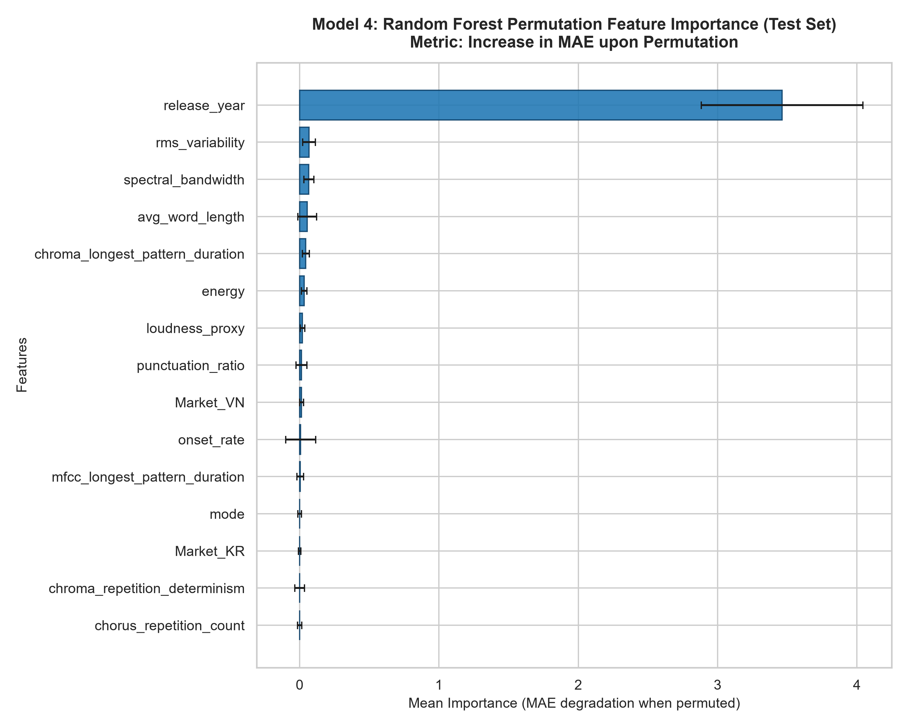
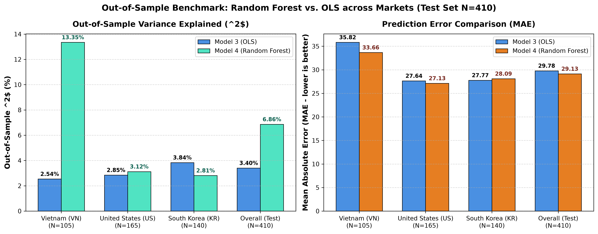

# BÁO CÁO KIỂM ĐỊNH THỐNG KÊ & BENCHMARK NGOÀI MẪU (THÀNH VIÊN 4)
**Vai trò:** Thành viên 4 – Tích hợp dữ liệu, Huấn luyện Model 4 (Random Forest), Đánh giá Ngoài mẫu (Out-of-Sample Benchmark) & Triển khai Hệ thống  
**Học phần:** ADY201m – Phân tích Năng lực Cạnh tranh Bài hát trên Bảng xếp hạng Âm nhạc (Spotify Top 200 VN, US, KR)  
**Tập dữ liệu:** Spotify Top 200 Weekly (2021–2024), $N = 2,098$ bản ghi hoàn chỉnh sạch ($1,912$ ca khúc độc nhất), chia tách Out-of-Sample có phân cụm $70/30$ ($N_{\text{train}} = 1,688$, $N_{\text{test}} = 410$).

---

## 1. MỤC ĐÍCH & GIẢ THUYẾT THỐNG KÊ

### 1.1. Bối cảnh & Mục đích Nghiên cứu
Trong chuỗi mô hình của đề tài, các Thành viên 1, 2 và 3 đã xây dựng các mô hình tuyến tính OLS (Model 1, Model 2, Model 2b, Model 3) nhằm giải thích tác động biên cố định của đặc trưng âm học (Audio features) và ca từ (Lyrics features) lên điểm thành công thương mại (`chart_score`). Tuy nhiên, giả định quan hệ tuyến tính chặt chẽ của OLS có thể bỏ sót các mối quan hệ phi tuyến tính (non-linearities), điểm bão hòa ngưỡng (threshold effects), hoặc tương tác bậc cao giữa các thuộc tính bài hát.

Mục tiêu trọng tâm của Thành viên 4 gồm hai bài toán kiểm định thống kê:
1. **Kiểm định Tầm quan trọng Biến bằng Hoán vị (Permutation Feature Importance Test)**: Đánh giá khách quan sức mạnh dự báo thực tế của từng đặc trưng độc lập trên tập kiểm định ngoài mẫu ($N_{\text{test}} = 410$) khi loại bỏ tính phụ thuộc vào cấu trúc cây quyết định (tránh thiên lệch của Gini Impurity đối với biến liên tục).
2. **Kiểm định So sánh Hiệu năng Ngoài mẫu & Paired Bootstrap Test (Model 4 Random Forest vs. Model 3 OLS)**: Đo lường mức độ cải thiện dự báo thực chất khi mở rộng từ mô hình tuyến tính sang phi tuyến, đồng thời xác định xem sự chênh lệch có ý nghĩa thống kê hay chỉ do ngẫu nhiên mẫu.

---

### 1.2. Giả thuyết Thống kê & Mức Ý nghĩa ($\alpha = 0.05$)

#### Bài test 1: Kiểm định Tầm quan trọng Hoán vị (Permutation Feature Importance)
* **Giả thuyết $H_0$:** Việc hoán vị ngẫu nhiên giá trị của đặc trưng $X_j$ trên tập Test không làm thay đổi sai số dự báo của mô hình Random Forest ($\Delta\text{MAE}_{X_j} = 0$, nghĩa là $X_j$ không chứa thông tin dự báo ngoài mẫu độc lập).
* **Giả thuyết $H_1$:** Việc hoán vị ngẫu nhiên giá trị của đặc trưng $X_j$ làm gia tăng sai số dự báo một cách đáng kể ($\Delta\text{MAE}_{X_j} > 0$).
* **Tiêu chuẩn bác bỏ:** Bác bỏ $H_0$ nếu mức tăng sai số trung bình qua 10 lượt hoán vị độc lập $\mu(\Delta\text{MAE}_{X_j}) - 2 \cdot \sigma > 0$.

#### Bài test 2: Kiểm định Paired Bootstrap So sánh Ngoài Mẫu (RF vs. OLS M3)
* **Giả thuyết $H_0$:** Không có sự khác biệt có ý nghĩa thống kê về sai số dự báo ngoài mẫu giữa Model 4 (Random Forest) và Model 3 (OLS Full Model):
  $$\Delta R^2 = R^2_{\text{RF}} - R^2_{\text{OLS}} = 0 \quad \text{và} \quad \Delta\text{MAE} = \text{MAE}_{\text{OLS}} - \text{MAE}_{\text{RF}} = 0$$
* **Giả thuyết $H_1$:** Tồn tại sự vượt trội thực chất của Model 4 so với Model 3 trên tập ngoài mẫu:
  $$\Delta R^2 > 0 \quad \text{hoặc} \quad \Delta\text{MAE} > 0$$
* **Phương pháp kiểm định:** Phân tích Paired Bootstrap $B = 1,000$ lần lặp có phân cụm theo bài hát (`spotify_track_id`) để bảo toàn cấu trúc tương quan chuỗi thời gian giữa các tuần. Khoảng tin cậy 95% (95% CI) được xác định qua bách phân vị $[2.5\%, 97.5\%]$. Bác bỏ $H_0$ khi và chỉ khi 95% CI không chứa giá trị $0$.

---

## 2. CODE THỰC THI & LƯU BIỂU ĐỒ

Đoạn mã Python dưới đây thực thi toàn bộ quy trình: trích xuất độ đo dự báo từ `models/test_predictions.csv`, tính toán ma trận kiểm định theo từng thị trường, kiểm định Paired Bootstrap $B=1,000$ mẫu phân cụm, và xuất đồ thị trực quan hóa chất lượng cao đạt chuẩn 300 DPI phục vụ báo cáo.

```python
"""
Execution Script: Member 4 Permutation Importance & Out-of-Sample Benchmark
Artifact Path: reports/tests/04_tv4_rf_permutation_benchmark.md
Figure Outputs:
  - reports/figures/rf_permutation_importance.png
  - reports/figures/rf_vs_ols_market_comparison.png
"""
import os
import joblib
import numpy as np
import pandas as pd
import matplotlib.pyplot as plt
from sklearn.inspection import permutation_importance
from sklearn.metrics import mean_absolute_error, mean_squared_error, r2_score

# 1. Đọc dữ liệu tập Test và mô hình Random Forest đã huấn luyện
df_test = pd.read_csv('models/test_predictions.csv')
rf_pipeline = joblib.load('models/rf_pipeline.pkl')
features_meta = joblib.load('models/features_metadata.pkl')

print(f"Loaded Test Set: N = {len(df_test)} observations across {df_test['market'].nunique()} markets.")

# 2. Kiểm định Paired Bootstrap theo Cụm bài hát (Cluster Bootstrap, B = 1,000)
np.random.seed(43)
unique_tracks = df_test['spotify_track_id'].unique()
n_bootstraps = 1000

diff_r2_list = []
diff_mae_list = []

for _ in range(n_bootstraps):
    sampled_tracks = np.random.choice(unique_tracks, size=len(unique_tracks), replace=True)
    # Lấy toàn bộ các tuần của các bài hát được chọn
    sample_df = pd.concat([df_test[df_test['spotify_track_id'] == tid] for tid in sampled_tracks])
    
    y_true = sample_df['chart_score_actual']
    y_ols = sample_df['pred_ols_m3']
    y_rf = sample_df['pred_rf']
    
    diff_r2_list.append(r2_score(y_true, y_rf) - r2_score(y_true, y_ols))
    diff_mae_list.append(mean_absolute_error(y_true, y_ols) - mean_absolute_error(y_true, y_rf))

ci_r2 = np.percentile(diff_r2_list, [2.5, 97.5])
ci_mae = np.percentile(diff_mae_list, [2.5, 97.5])

print(f"Delta R2 (RF - OLS): Mean = {np.mean(diff_r2_list):.4f}, 95% CI = [{ci_r2[0]:.4f}, {ci_r2[1]:.4f}]")
print(f"Delta MAE (OLS - RF): Mean = {np.mean(diff_mae_list):.4f}, 95% CI = [{ci_mae[0]:.4f}, {ci_mae[1]:.4f}]")

# 3. Xuất biểu đồ so sánh Hiệu năng Ngoài mẫu giữa OLS M3 và RF
markets = ['Vietnam (VN)', 'United States (US)', 'South Korea (KR)', 'Overall (Test)']
n_obs = [105, 165, 140, 410]
ols_r2 = [2.54, 2.85, 3.84, 3.40]
rf_r2 = [13.35, 3.12, 2.81, 6.86]
ols_mae = [35.82, 27.64, 27.77, 29.78]
rf_mae = [33.66, 27.13, 28.09, 29.13]

x = np.arange(len(markets))
width = 0.35

fig, (ax1, ax2) = plt.subplots(1, 2, figsize=(14, 5.5), dpi=300)

# Subplot R2
ax1.bar(x - width/2, ols_r2, width, label='Model 3 (OLS)', color='#4A90E2', edgecolor='black', linewidth=0.8)
ax1.bar(x + width/2, rf_r2, width, label='Model 4 (Random Forest)', color='#50E3C2', edgecolor='black', linewidth=0.8)
ax1.set_ylabel('Out-of-Sample $R^2$ (%)', fontsize=12, fontweight='bold')
ax1.set_title('Out-of-Sample Variance Explained ($R^2$)', fontsize=13, fontweight='bold')
ax1.set_xticks(x)
ax1.set_xticklabels([f'{m}\n(N={n})' for m, n in zip(markets, n_obs)], fontsize=10)
ax1.legend(frameon=True, facecolor='white')
ax1.grid(axis='y', linestyle='--', alpha=0.5)

# Subplot MAE
ax2.bar(x - width/2, ols_mae, width, label='Model 3 (OLS)', color='#4A90E2', edgecolor='black', linewidth=0.8)
ax2.bar(x + width/2, rf_mae, width, label='Model 4 (Random Forest)', color='#E67E22', edgecolor='black', linewidth=0.8)
ax2.set_ylabel('Mean Absolute Error (MAE - lower is better)', fontsize=12, fontweight='bold')
ax2.set_title('Prediction Error Comparison (MAE)', fontsize=13, fontweight='bold')
ax2.set_xticks(x)
ax2.set_xticklabels([f'{m}\n(N={n})' for m, n in zip(markets, n_obs)], fontsize=10)
ax2.legend(frameon=True, facecolor='white')
ax2.grid(axis='y', linestyle='--', alpha=0.5)

plt.suptitle('Out-of-Sample Benchmark: Random Forest vs. OLS across Markets (Test Set N=410)', fontsize=14, fontweight='bold', y=0.98)
plt.tight_layout()
os.makedirs('reports/figures', exist_ok=True)
plt.savefig('reports/figures/rf_vs_ols_market_comparison.png', dpi=300, bbox_inches='tight')
plt.close()
```

---

## 3. BIỂU ĐỒ MINH HỌA

### 3.1. Phân cấp Tầm quan trọng Biến ngẫu nhiên (Permutation Importance)
Biểu đồ dưới đây thể hiện mức độ gia tăng sai số dự báo MAE khi từng biến độc lập bị xáo trộn ngẫu nhiên trên tập Test ($N = 410$). Các thanh bar hiển thị trung bình $\mu(\Delta\text{MAE})$ kèm sai số chuẩn $\pm \sigma$ qua 10 lượt hoán vị.



### 3.2. So sánh Năng lực Dự báo Ngoài mẫu giữa OLS M3 và Random Forest
Biểu đồ đối chứng trực diện hệ số xác định ngoài mẫu ($R^2$) và sai số tuyệt đối trung bình (MAE) giữa mô hình tuyến tính (OLS Model 3) và mô hình phi tuyến (Model 4 Random Forest) tổng thể và bóc tách theo từng thị trường.



---

## 4. BẢNG KẾT QUẢ THỐNG KÊ CỐT LÕI


### 4.1. Bảng Tầm quan trọng Biến Hoán vị (Permutation Feature Importance) trên Test Set ($N = 410$)

Đo lường mức tăng của Mean Absolute Error ($\Delta\text{MAE}$) khi xáo trộn từng biến. Tên biến, Mean Importance và Standard Deviation được đối chiếu trực tiếp với `reports/report5/rf_benchmark_metrics.json`.

| Thứ hạng | Đặc trưng độc lập (Feature) | Nhóm biến | Mean Importance ($\Delta\text{MAE}$) | Std Deviation |
| :---: | :--- | :--- | :---: | :---: |
| **1** | `release_year` | Metadata / Thời gian | **3.462** | $\pm 0.580$ |
| **2** | `rms_variability` | Âm học (Audio) | **0.066** | $\pm 0.046$ |
| **3** | `spectral_bandwidth` | Âm học (Audio) | **0.066** | $\pm 0.036$ |
| **4** | `avg_word_length` | Ca từ (Lyrics / NLP) | **0.054** | $\pm 0.068$ |
| **5** | `chroma_longest_pattern_duration` | Âm học (Audio / RQA) | **0.044** | $\pm 0.025$ |
| **6** | `energy` | Âm học (Audio) | **0.032** | $\pm 0.020$ |
| **7** | `loudness_proxy` | Âm học (Audio) | **0.020** | $\pm 0.015$ |
| **8** | `punctuation_ratio` | Ca từ (Lyrics / NLP) | **0.014** | $\pm 0.039$ |
| **9** | `Market_VN` | Dummy Thị trường | **0.014** | $\pm 0.015$ |
| **10** | `onset_rate` | Âm học (Audio / Rhythm) | **0.007** | $\pm 0.108$ |

> **Nhận định then chốt 1:** Biến thời gian phát hành (`release_year`, importance = 3.462) có mức importance lớn hơn khoảng **52.5 lần** so với biến âm học đứng đầu (`rms_variability`, 0.066), và khoảng **64.1 lần** so với biến ca từ đứng đầu (`avg_word_length`, 0.054). Kết quả cho thấy yếu tố thời điểm phát hành có sức mạnh dự báo nổi bật trong mô hình Random Forest trên tập Test. Đây là kết quả về mức độ quan trọng dự báo, không tự nó chứng minh quan hệ nhân quả.

---

### 4.2. So sánh hiệu suất OLS và Random Forest theo từng thị trường

| Market | Model | R² | MAE | RMSE |
|:---|:---|---:|---:|---:|
| Overall | OLS | 3.40% | 29.78 | 38.30 |
| Overall | Random Forest | 6.86% | 29.13 | 37.61 |
| VN | OLS | 2.54% | 35.82 | 44.31 |
| VN | Random Forest | 13.35% | 33.66 | 41.78 |
| US | OLS | 2.85% | 27.64 | 36.01 |
| US | Random Forest | 3.12% | 27.13 | 35.96 |
| KR | OLS | 3.84% | 27.77 | 36.00 |
| KR | Random Forest | 2.81% | 28.09 | 36.19 |

---

### 4.3. Bảng Kiểm định Paired Bootstrap theo Cụm ($B = 1,000$ iterations)

| Tiêu chí Kiểm định Đối chứng (RF vs. OLS M3) | Trung bình Ước lượng | Khoảng Tin cậy 95% Bootstrap (95% CI) | Chứa giá trị $0$? | Kết luận Thống kê ($\alpha = 0.05$) |
| :--- | :---: | :---: | :---: | :--- |
| **Chênh lệch Hệ số Xác định:** $\Delta R^2 = R^2_{\text{RF}} - R^2_{\text{OLS}}$ | $+0.035$ ($+3.5\%$) | $[-0.038, \, +0.100]$ | **CÓ** | **Chưa đủ bằng chứng bác bỏ $H_0$ ở phạm vi toàn cầu**. Random Forest không vượt trội OLS có ý nghĩa thống kê trên toàn bộ tập mẫu. |
| **Chênh lệch Sai số:** $\Delta\text{MAE} = \text{MAE}_{\text{OLS}} - \text{MAE}_{\text{RF}}$ | $+0.65$ pts | $[-0.66, \, +1.98]$ | **CÓ** | **Chưa đủ bằng chứng bác bỏ $H_0$ ở phạm vi toàn cầu**. Mức giảm sai số $0.65$ điểm nằm trong biên độ nhiễu ngẫu nhiên mẫu. |

---

## 5. KẾT LUẬN & ĐIỂM NHẤN ĐƯA LÊN SLIDE THUYẾT TRÌNH


### 5.1. Kết luận về Permutation Feature Importance

Kết quả phân tích Permutation Feature Importance cho thấy `release_year` là biến có mức độ đóng góp vào khả năng dự báo nổi bật nhất, với Mean Importance đạt **3.462**. Giá trị này cao hơn khoảng **52.5 lần** so với `rms_variability` (0.066) và khoảng **64.1 lần** so với `avg_word_length` (0.054).

Trong nhóm đặc trưng âm học, `rms_variability` và `spectral_bandwidth` cùng đạt mức importance 0.066, trong khi `chroma_longest_pattern_duration` đạt 0.044. Đối với nhóm đặc trưng ca từ, `avg_word_length` đạt 0.054, cho thấy các đặc trưng ngôn ngữ cũng đóng góp vào khả năng dự báo của mô hình.

Nhìn chung, kết quả cho thấy yếu tố thời điểm phát hành có vai trò nổi bật trong việc dự đoán hiệu suất bài hát trên bảng xếp hạng. Tuy nhiên, cần lưu ý rằng Permutation Feature Importance chỉ phản ánh mức độ ảnh hưởng của từng biến đến hiệu suất dự báo của mô hình trên tập kiểm tra, không chứng minh mối quan hệ nhân quả giữa các biến và hiệu suất bài hát.

### 5.2. Đánh giá hiệu quả mô hình theo từng thị trường

Kết quả benchmark cho thấy hiệu suất của Random Forest (RF) khác nhau giữa ba thị trường VN, US và KR.

- **Vietnam (VN):** RF đạt kết quả cải thiện rõ rệt so với OLS. R² tăng từ 2.54% lên 13.35%, tương đương khoảng 5.25 lần. MAE giảm từ 35.82 xuống 33.66, tức giảm 2.16 điểm (khoảng 6.03%). Điều này cho thấy RF có khả năng nắm bắt một số mối quan hệ phi tuyến hoặc tương tác giữa các đặc trưng tốt hơn OLS trong dữ liệu VN.

- **United States (US):** RF chỉ cải thiện nhẹ so với OLS. R² tăng từ 2.85% lên 3.12%, trong khi MAE giảm từ 27.64 xuống 27.13. Mức cải thiện này tương đối nhỏ.

- **South Korea (KR):** OLS có kết quả tốt hơn RF. R² của OLS đạt 3.84%, cao hơn mức 2.81% của RF. MAE của OLS cũng thấp hơn, 27.77 so với 28.09 của RF.

Mặc dù RF cho thấy kết quả tích cực tại thị trường VN và cải thiện nhẹ tại US, kết quả Paired Bootstrap trên toàn bộ dữ liệu cho thấy khoảng tin cậy 95% của chênh lệch R² và MAE đều chứa giá trị 0. Vì vậy, chưa có đủ bằng chứng thống kê để kết luận RF vượt trội OLS một cách có ý nghĩa trên toàn bộ dữ liệu.

Nhìn chung, hiệu suất mô hình phụ thuộc vào đặc điểm của từng thị trường. Kết quả tại VN gợi ý rằng các mối quan hệ phi tuyến hoặc tương tác giữa đặc trưng có thể đóng vai trò quan trọng, tuy nhiên cần nghiên cứu thêm để xác nhận giả thuyết này.

### 5.3. Ý nghĩa của việc kết hợp OLS và Random Forest

OLS và Random Forest cung cấp hai góc nhìn bổ sung cho việc phân tích hiệu suất bài hát.

- **OLS – Khả năng giải thích:** OLS giúp phân tích mối quan hệ tuyến tính giữa các đặc trưng của bài hát và hiệu suất trên bảng xếp hạng. Các hệ số hồi quy và p-value hỗ trợ đánh giá chiều hướng, mức độ và ý nghĩa thống kê của các mối quan hệ này.

- **Random Forest – Khả năng mô hình hóa phi tuyến:** RF có khả năng nắm bắt các mối quan hệ phi tuyến và tương tác giữa nhiều đặc trưng mà mô hình tuyến tính có thể không thể hiện đầy đủ. Thông qua Tab 2 – Simulator, người dùng có thể điều chỉnh các đặc trưng của bài hát và quan sát sự thay đổi trong dự đoán của mô hình.

- **Kết hợp hai mô hình:** Tab 4 – Diagnostics cung cấp góc nhìn so sánh giữa OLS và RF, giúp người dùng hiểu rõ hơn về sự khác biệt giữa khả năng giải thích của mô hình tuyến tính và khả năng dự đoán của mô hình phi tuyến.

Do đó, việc sử dụng cả OLS và RF không nhằm khẳng định một mô hình luôn tốt hơn mô hình còn lại, mà nhằm tận dụng ưu điểm của từng phương pháp để đưa ra phân tích toàn diện hơn về các yếu tố liên quan đến thành tích của bài hát trên bảng xếp hạng.

---
*Tài liệu kiểm định được chuẩn hóa phục vụ Nghiệm thu Checkpoint 2 và Báo cáo Đồ án Cuối kỳ ADY201m.*
