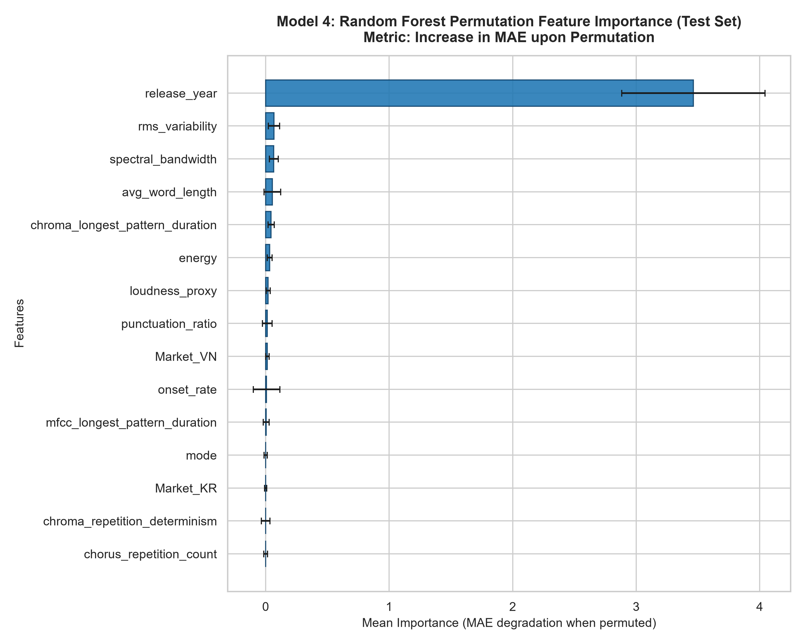
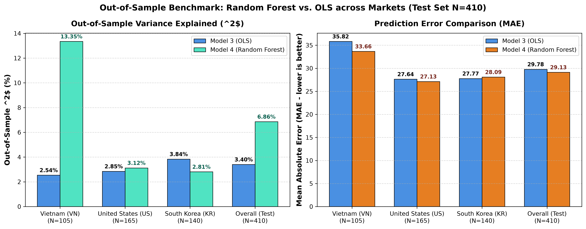

# BÁO CÁO KIỂM ĐỊNH THỐNG KÊ & BENCHMARK NGOÀI MẪU (THÀNH VIÊN 4)

**Vai trò:** Thành viên 4 – Tích hợp dữ liệu, Huấn luyện Model 4 (Random Forest), Đánh giá ngoài mẫu (Out-of-Sample Benchmark) và triển khai hệ thống  
**Học phần:** ADY201m – Phân tích Năng lực Cạnh tranh Bài hát trên Bảng xếp hạng Âm nhạc (Spotify Top 200 VN, US, KR)  
**Tập dữ liệu:** Spotify Top 200 Weekly (2021–2024, theo thông tin trong bản báo cáo hiện tại), với \(N = 2,098\) bản ghi hoàn chỉnh và 1,912 ca khúc độc nhất. Tập Test gồm 410 quan sát. Tập huấn luyện Random Forest gồm 1,688 quan sát.

> **Lưu ý về phạm vi thời gian:** Bản review TV1 đề nghị cập nhật phạm vi dữ liệu thành 2021–2026. Chưa có đủ bằng chứng trong các tệp đã đối chiếu để xác nhận năm kết thúc. Vì vậy, báo cáo tạm giữ 2021–2024 theo bản dữ liệu hiện có; cần xác minh ngày nhỏ nhất/lớn nhất trong dữ liệu nguồn trước khi đổi thành 2021–2026.

---

## 1. MỤC ĐÍCH & GIẢ THUYẾT THỐNG KÊ

### 1.1. Bối cảnh & mục đích nghiên cứu

Trong chuỗi mô hình của đề tài, các Thành viên 1, 2 và 3 đã xây dựng các mô hình hồi quy tuyến tính OLS (Model 1, Model 2, Model 2b và Model 3) nhằm phân tích mối quan hệ giữa đặc trưng âm học (Audio features), đặc trưng ca từ (Lyrics features) và điểm thành công thương mại (`chart_score`). Tuy nhiên, mô hình tuyến tính có thể chưa mô tả đầy đủ các quan hệ phi tuyến, hiệu ứng ngưỡng hoặc tương tác giữa các thuộc tính bài hát.

Mục tiêu của Thành viên 4 gồm hai nội dung:

1. **Permutation Feature Importance (PFI):** Đánh giá mức độ thay đổi sai số dự báo ngoài mẫu khi hoán vị từng đặc trưng trên tập Test.
2. **Out-of-Sample Benchmark và Paired Bootstrap:** So sánh hiệu suất dự báo của Random Forest (Model 4) với OLS Model 3, đồng thời đánh giá độ bất định của chênh lệch hiệu suất bằng phương pháp Bootstrap theo cụm bài hát.

### 1.2. Giả thuyết thống kê và mức ý nghĩa (\(\alpha = 0.05\))

#### Bài test 1: Permutation Feature Importance

- **Giả thuyết \(H_0\):** Hoán vị giá trị của đặc trưng \(X_j\) không làm tăng sai số dự báo MAE của Random Forest trên tập Test; tức mức tăng MAE không lớn hơn 0.
- **Giả thuyết \(H_1\):** Hoán vị giá trị của đặc trưng \(X_j\) làm tăng sai số dự báo MAE của Random Forest.
- **Tiêu chí đánh giá được sử dụng trong báo cáo:** \(\mu(\Delta MAE_{X_j}) - 2\sigma_{X_j} > 0\), trong đó \(\mu\) và \(\sigma\) lần lượt là Mean Importance và độ lệch chuẩn qua các lượt hoán vị. Đây là ngưỡng đánh giá bảo thủ được dùng để diễn giải kết quả PFI, không nên gọi là một kiểm định giả thuyết độc lập nếu chưa thực hiện kiểm định suy luận tương ứng.

#### Bài test 2: Paired Bootstrap so sánh RF và OLS Model 3

- **Giả thuyết \(H_0\):** Random Forest không có sai số dự báo ngoài mẫu thấp hơn OLS Model 3:

  \[
  \Delta MAE = MAE_{OLS} - MAE_{RF} \leq 0
  \]

- **Giả thuyết \(H_1\):** Random Forest có sai số dự báo ngoài mẫu thấp hơn OLS Model 3:

  \[
  \Delta MAE = MAE_{OLS} - MAE_{RF} > 0
  \]

- **Chỉ tiêu đánh giá bổ sung:** Chênh lệch \(R^2\) giữa hai mô hình được báo cáo để mô tả mức độ giải thích biến thiên của dữ liệu; đây không phải tiêu chí chính để kết luận H1.
- **Phương pháp:** Paired Cluster Bootstrap với \(B = 1,000\) lần lặp, lấy mẫu theo `spotify_track_id` và giữ lại toàn bộ quan sát theo tuần của các bài hát được chọn. Khoảng tin cậy 95% được tính bằng percentile interval tại các bách phân vị 2.5% và 97.5%. Theo quy tắc báo cáo này, chỉ kết luận RF vượt trội về MAE khi cận dưới của khoảng tin cậy 95% của \(\Delta MAE\) lớn hơn 0.

---

## 2. PHẠM VI CODE VÀ KHẢ NĂNG TÁI LẬP

Các kết quả benchmark theo thị trường được đối chiếu với `reports/model_test_comparison.csv` và `reports/report5/rf_benchmark_metrics.json`. Bảng PFI ở Mục 4.1 sử dụng các giá trị trong `reports/report5/rf_benchmark_metrics.json`.

**Lưu ý về khả năng tái lập:** Đoạn code cũ trong báo cáo có tham chiếu `models/features_metadata.pkl`, trong khi tệp này không được tìm thấy tại đường dẫn đó trên nhánh đã kiểm tra. Code cũ cũng import `permutation_importance` nhưng không sử dụng, đồng thời nhập trực tiếp các số liệu benchmark để vẽ biểu đồ. Vì vậy, không nên mô tả đoạn code cũ là quy trình tự động thực thi toàn bộ PFI, benchmark và Bootstrap.

Đặc biệt, các giá trị Bootstrap trong Bảng 4.3 chưa được xác minh là đầu ra của đoạn code cũ. Không được tuyên bố rằng đoạn code dưới đây tái tạo chính xác Bảng 4.3 cho đến khi chạy lại từ dữ liệu dự đoán và đối chiếu log kết quả. Bảng 4.3 hiện được giữ lại như kết quả đã có trong bản báo cáo, với nguồn tính toán cần được xác nhận bổ sung.

Đoạn code sau minh họa cách tính lại các chỉ số benchmark theo từng thị trường trực tiếp từ `models/test_predictions.csv`; code không thay thế việc xác minh nguồn Bootstrap:

```python
import pandas as pd
from sklearn.metrics import mean_absolute_error, mean_squared_error, r2_score

df = pd.read_csv("models/test_predictions.csv")

required_columns = {
    "market", "chart_score_actual", "pred_ols_m3", "pred_rf"
}
missing = required_columns - set(df.columns)
if missing:
    raise ValueError(f"Missing required columns: {sorted(missing)}")

def calculate_metrics(group, prediction_column):
    y_true = group["chart_score_actual"]
    y_pred = group[prediction_column]
    return {
        "N": len(group),
        "R2": r2_score(y_true, y_pred),
        "MAE": mean_absolute_error(y_true, y_pred),
        "RMSE": mean_squared_error(y_true, y_pred) ** 0.5,
    }

rows = []
for market, group in df.groupby("market"):
    for model, prediction_column in [
        ("OLS", "pred_ols_m3"),
        ("Random Forest", "pred_rf"),
    ]:
        rows.append({
            "Market": market,
            "Model": model,
            **calculate_metrics(group, prediction_column),
        })

for model, prediction_column in [
    ("OLS", "pred_ols_m3"),
    ("Random Forest", "pred_rf"),
]:
    rows.append({
        "Market": "Overall",
        "Model": model,
        **calculate_metrics(df, prediction_column),
    })

benchmark = pd.DataFrame(rows)
print(benchmark.to_string(index=False))
```

---

## 3. BIỂU ĐỒ MINH HỌA

### 3.1. Permutation Feature Importance

Biểu đồ thể hiện mức tăng sai số dự báo MAE khi từng biến độc lập bị hoán vị ngẫu nhiên trên tập Test (\(N = 410\)). Các thanh biểu diễn Mean Importance và độ lệch chuẩn qua các lượt hoán vị.



### 3.2. So sánh hiệu suất dự báo ngoài mẫu giữa OLS Model 3 và Random Forest

Biểu đồ đối chiếu \(R^2\) và MAE giữa mô hình OLS Model 3 và Random Forest trên toàn bộ tập Test cũng như từng thị trường.



---

## 4. BẢNG KẾT QUẢ THỐNG KÊ CỐT LÕI

### 4.1. Bảng Permutation Feature Importance trên Test Set (\(N = 410\))

Đo lường mức tăng Mean Absolute Error (\(\Delta MAE\)) khi hoán vị từng biến. Tên biến, Mean Importance và Standard Deviation được đối chiếu với `reports/report5/rf_benchmark_metrics.json`.

| Thứ hạng | Đặc trưng độc lập (Feature) | Nhóm biến | Mean Importance (\(\Delta MAE\)) | Std Deviation |
|:---:|:---|:---|---:|---:|
| **1** | `release_year` | Metadata / Thời gian | **3.462** | 0.580 |
| **2** | `rms_variability` | Âm học (Audio) | **0.066** | 0.046 |
| **3** | `spectral_bandwidth` | Âm học (Audio) | **0.066** | 0.036 |
| **4** | `avg_word_length` | Ca từ (Lyrics / NLP) | **0.054** | 0.068 |
| **5** | `chroma_longest_pattern_duration` | Âm học (Audio / RQA) | **0.044** | 0.025 |
| **6** | `energy` | Âm học (Audio) | **0.032** | 0.020 |
| **7** | `loudness_proxy` | Âm học (Audio) | **0.020** | 0.015 |
| **8** | `punctuation_ratio` | Ca từ (Lyrics / NLP) | **0.014** | 0.039 |
| **9** | `Market_VN` | Dummy thị trường | **0.014** | 0.015 |
| **10** | `onset_rate` | Âm học (Audio / Rhythm) | **0.007** | 0.108 |

> **Nhận định:** `release_year` có Mean Importance 3.462, cao hơn khoảng 52.5 lần so với `rms_variability` (0.066) và khoảng 64.1 lần so với `avg_word_length` (0.054). Đây là so sánh độ lớn Mean Importance, không đồng nghĩa tất cả biến còn lại đều đạt tiêu chí ổn định \(\mu - 2\sigma > 0\).

### 4.2. So sánh hiệu suất OLS và Random Forest theo từng thị trường

| Market | Model | R² | MAE | RMSE |
|:---|:---|---:|---:|---:|
| Overall | OLS | 3.40% | 29.78 | 38.30 |
| Overall | Random Forest | 6.86% | 29.13 | 37.61 |
| VN | OLS | 2.54% | 35.82 | 44.31 |
| VN | Random Forest | 13.35% | 33.66 | 41.78 |
| US | OLS | 2.85% | 27.64 | 36.01 |
| US | Random Forest | 3.12% | 27.13 | 35.96 |
| KR | OLS | 3.84% | 27.77 | 36.00 |
| KR | Random Forest | 2.81% | 28.09 | 36.19 |

### 4.3. Bảng kết quả Paired Bootstrap theo cụm (\(B = 1,000\))

**Nguồn và khả năng tái lập:** Các giá trị dưới đây được giữ nguyên từ bản báo cáo trước đó. Chúng chưa được xác nhận là đầu ra của đoạn code mô tả ở Mục 2. Cần bổ sung tệp kết quả/log Bootstrap gốc hoặc chạy lại phép tính từ `models/test_predictions.csv` trước khi xem đây là kết quả đã tái lập độc lập.

| Tiêu chí | Trung bình ước lượng | Khoảng tin cậy 95% Bootstrap | Chứa 0? | Diễn giải |
|:---|---:|:---:|:---:|:---|
| \(\Delta R^2 = R^2_{RF} - R^2_{OLS}\) | +0.035 (+3.5 điểm %) | [-0.038, +0.100] | Có | Chưa đủ bằng chứng cho thấy RF cải thiện \(R^2\) có ý nghĩa thống kê trên toàn bộ tập Test. Đây là chỉ tiêu bổ sung. |
| \(\Delta MAE = MAE_{OLS} - MAE_{RF}\) | +0.65 điểm | [-0.66, +1.98] | Có | Khoảng tin cậy chứa 0; chưa đủ bằng chứng bác bỏ \(H_0\) theo tiêu chí MAE chính. |

---

## 5. KẾT LUẬN & ĐIỂM NHẤN ĐƯA LÊN SLIDE THUYẾT TRÌNH

### 5.1. Kết luận về Permutation Feature Importance

Kết quả Permutation Feature Importance cho thấy `release_year` có Mean Importance cao nhất, đạt **3.462** với độ lệch chuẩn **0.580**. Theo tiêu chí đánh giá tại Mục 1.2, chỉ biến `release_year` thỏa mãn điều kiện:

\[
\mu - 2\sigma > 0
\]

Cụ thể:

\[
3.462 - 2(0.580) = 2.302 > 0
\]

Đối với 9 biến còn lại, mặc dù Mean Importance đều dương, không biến nào thỏa mãn tiêu chí trên. Vì vậy, theo ngưỡng đánh giá đã chọn, chưa có đủ bằng chứng để kết luận các biến âm học và ca từ có mức importance tách biệt rõ khỏi nhiễu hoán vị.

Các biến như `rms_variability`, `spectral_bandwidth` và `avg_word_length` vẫn có Mean Importance dương trong kết quả PFI. Tuy nhiên, không nên diễn giải điều này thành bằng chứng rằng chúng có đóng góp dự báo ổn định theo tiêu chí \(\mu - 2\sigma > 0\).

Nhìn chung, `release_year` là biến duy nhất vượt qua ngưỡng đánh giá bảo thủ trong phân tích này. PFI phản ánh mức độ hữu ích của biến đối với khả năng dự báo của mô hình trên tập Test, không chứng minh mối quan hệ nhân quả.

### 5.2. Đánh giá hiệu quả mô hình theo từng thị trường

Kết quả benchmark cho thấy hiệu suất của Random Forest (RF) khác nhau giữa ba thị trường VN, US và KR.

- **Vietnam (VN):** Trên tập Test quan sát được, RF đạt \(R^2 = 13.35\%\), cao hơn OLS với \(R^2 = 2.54\%\). MAE giảm từ 35.82 xuống 33.66, tương ứng giảm 2.16 điểm. Đây là mức cải thiện đáng chú ý về mặt mô tả và gợi ý RF có thể mô hình hóa một số quan hệ mà OLS chưa thể hiện tốt trong dữ liệu VN.
- **United States (US):** RF cải thiện nhẹ so với OLS. \(R^2\) tăng từ 2.85% lên 3.12%, trong khi MAE giảm từ 27.64 xuống 27.13.
- **South Korea (KR):** OLS có kết quả tốt hơn RF. \(R^2\) của OLS đạt 3.84%, cao hơn mức 2.81% của RF. MAE của OLS cũng thấp hơn, 27.77 so với 28.09.

Các kết quả trên chỉ mang tính mô tả theo từng thị trường. Khoảng tin cậy Bootstrap đang được báo cáo là kết quả toàn bộ tập Test, chưa phải khoảng tin cậy riêng cho từng thị trường. Vì vậy, chưa thể kết luận mức cải thiện tại VN có ý nghĩa thống kê hoặc khẳng định nguyên nhân là do quan hệ phi tuyến.

Nhìn chung, hiệu suất của mô hình khác nhau giữa các thị trường. Kết quả gợi ý cần tiếp tục nghiên cứu đặc điểm dữ liệu và cấu trúc dự báo riêng của từng thị trường.

### 5.3. Ý nghĩa của việc kết hợp OLS và Random Forest

OLS và Random Forest cung cấp hai góc nhìn bổ sung cho việc phân tích hiệu suất bài hát.

- **OLS – Khả năng giải thích:** OLS hỗ trợ phân tích mối quan hệ tuyến tính giữa các đặc trưng của bài hát và hiệu suất trên bảng xếp hạng. Hệ số hồi quy và p-value giúp đánh giá chiều hướng, độ lớn và ý nghĩa thống kê của các mối quan hệ trong phạm vi giả định của mô hình.
- **Random Forest – Khả năng mô hình hóa:** RF có khả năng mô hình hóa quan hệ phi tuyến và tương tác giữa nhiều đặc trưng. Thông qua Tab 2 – Simulator, người dùng có thể điều chỉnh các đặc trưng đầu vào và quan sát thay đổi trong dự đoán của mô hình.
- **Kết hợp hai mô hình:** Tab 4 – Diagnostics hỗ trợ so sánh kết quả OLS và RF, giúp người dùng quan sát sự khác biệt giữa mô hình tuyến tính và mô hình dự báo dựa trên cây.

Việc sử dụng cả OLS và RF không nhằm khẳng định một mô hình luôn tốt hơn mô hình còn lại, mà nhằm tận dụng ưu điểm của từng phương pháp để đưa ra phân tích toàn diện hơn về các yếu tố liên quan đến thành tích của bài hát trên bảng xếp hạng.

---

*Tài liệu kiểm định phục vụ Báo cáo Đồ án Cuối kỳ ADY201m.*
